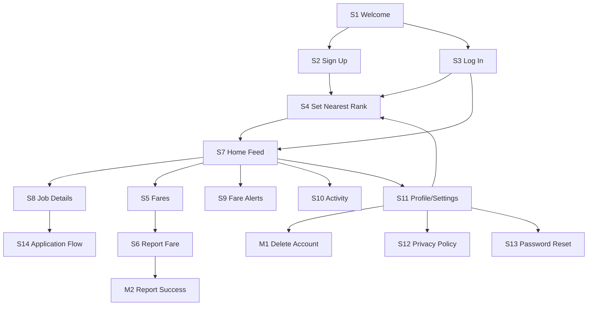

# IMPLEMENTATION_PLAN.md: Indlela

---

## 0. Plan details

| Field | Value |
| --- | --- |
| App name | Indlela |
| Built from PRD version | v0.4 |
| Screen designs | https://stitch.withgoogle.com/projects/3597720798231985125 (S1–S14, M1–M2) |
| Plan version | v1.0 |
| Repository | https://github.com/ThamiRoneo/indlela-mvp |
| Status | Ready to build |
| Last updated | 3 Nov 2026 |

---

## 1. Start here (instructions for the coding agent)

Before writing any code:

1. Read this whole file from top to bottom.
2. Read `docs/PRD.md`.
3. Look at the screen designs listed in Section 7.3.
4. Check Section 18. If any clarification is still **Open**, stop and ask the human. Do not start.
5. Check that the prerequisites in Section 4.2 are installed.
6. Start **Phase 1 only**. Follow Section 2 at all times.

---

## 2. Rules for the coding agent (copy word for word, do not edit)

1. **One phase at a time.** Only work on the phase the human asked for. When that phase's Definition of Done is complete, stop and wait for the human to say "Start Phase <number>".
2. **Test-driven development (TDD) for every task.** Follow the cycle in Section 12.1:
    - Write the test.
    - Run it and see it fail for the right reason.
    - Write the smallest code that makes it pass.
    - Run all tests.
    - Refactor while all tests still pass.
3. **Never cheat a test.** Never delete, skip, weaken or change a test just to make it pass. If you believe a test is wrong, stop and explain why to the human.
4. **Never break earlier work.** Every test from earlier phases must still pass before a phase is done.
5. **Build only what is planned.** Build only what is in this file and `docs/PRD.md`. Never build anything in Section 3.3 (Deferred).
6. **Ask, don't guess.** If anything is missing, unclear or contradictory, stop, add it to Section 18, and ask the human.
7. **Match the designs.** Every screen must match its design in Section 7.3: layout, order, labels, text, colours and spacing. Use the design tokens in Section 7.1. Never hard-code colours, font sizes or spacing.
8. **Every state, every screen.** Each screen must handle every state listed for it in Section 7.3 (chosen from normal, empty, loading, error, offline, success, plus any screen-specific states).
9. **Exact wording.** Use the exact labels and messages from the PRD. Never invent wording.
10. **Security first.**
    - Never put secret keys in app code, logs, test files or Git.
    - Every permission rule in Section 9 must be enforced on the server or database, never only in the app.
    - Every permission rule must have a test.
11. **Full check before "done".** Run the full check command (Section 4.3) before saying a phase is done, then add a short summary of the results to the Progress log (Section 17).
12. **Record your progress.** After each phase:
    - tick the checkboxes for that phase in this file;
    - add a row to the Progress log;
    - commit using the commit message given in the phase.
13. **No surprise libraries.** Do not add, remove or upgrade any library or tool not listed in Section 4.1 without asking the human first.
14. **Stuck rule.** If the same problem is still failing after 3 attempts, stop and report:
    - what you tried;
    - the exact error;
    - what you need from the human.
15. **Clean code.** Follow the folder structure in Section 5. Use the PRD's key terms (Section 3.4) for names in code. Keep files small and focused.

---

## 3. Project summary and scope

### 3.1 Summary

Indlela is a mobile-first app that makes job seeking affordable for unemployed youth (18–35) in Rustenburg, North West. It uses a crowdsourced Dynamic Fare Index to keep up-to-date minibus taxi fares per rank and route, and an Affordability-First Job Feed that sorts opportunities by net gain (estimated wage minus transport cost). Users can filter to "Jobs I can afford this week" based on their weekly transport budget. The app caches fares offline for low-data use.

**Platform:** Android mobile app (built and tested on Android first). iPhone is a future feature.

### 3.2 Features in scope

| ID | Feature | Priority | Built in phase |
| --- | --- | --- | --- |
| F1 | Onboarding & Accounts | Must | 3 |
| F2 | Dynamic Fare Index | Must | 4 |
| F3 | Affordability-First Job Feed | Must | 5 |
| F4 | Fare Alerts & Budgeting | Should | 6 |
| F5 | Data-light & Offline Support | Should | 7 |

### 3.3 Deferred: do NOT build

- Full ride hailing/carousel booking: No booking of taxis/cars in v1.
- General carpooling: Open carpooling removed.
- Voucher redemption system: Not in v1.
- User-to-user messaging: No chat/messaging in v1.
- Push notifications at scale: Basic in-app alerts only if simple.
- Expanding beyond Rustenburg at launch: Focus solely on Rustenburg, North West for MVP.
- iPhone app
- Fare voucher wallet
- Rank-based carpools
- Expansion to other areas
- Push notifications (beyond basic in-app alerts)

### 3.4 Key terms (use these names in code)

| Term (PRD 1.7) | Name in code | Meaning |
| --- | --- | --- |
| Rank | `Rank`, table `ranks` | A designated minibus taxi rank from which users depart for routes |
| Route | `Route`, table `routes` | A specific rank-to-destination route with a current estimated fare |
| Fare Report | `FareReport`, table `fare_reports` | A crowdsourced user submission of the current fare for a specific Route from a specific Rank |
| Dynamic Fare Index | `DynamicFareIndex` | The app's up-to-date store of fares per Route/Rank, built from Fare Reports |
| Job Listing | `JobListing`, table `job_listings` | An opportunity shown in the Affordability-First Job Feed |
| Net Gain | `net_gain` | Estimated wage minus estimated transport cost (to and from) |
| Affordability Filter | `affordability_filter` | "Jobs I can afford this week" filter |

---

## 4. Tech stack, prerequisites and commands

### 4.1 Stack

| Layer | Tool | Version | Used for |
| --- | --- | --- | --- |
| Frontend | React Native + Expo | Latest stable Expo SDK at setup | App screens and navigation (Android first) |
| Language | TypeScript (strict mode) | Bundled with Expo | All app, test and script code |
| Styling | NativeWind | Version that supports chosen Expo SDK | Styling using design tokens |
| Backend and database | Supabase: PostgreSQL, Auth, Storage | Supabase CLI latest | Data, log-in, fares, jobs |
| Server functions | Supabase Edge Functions | Supabase CLI latest | Account deletion (needs secret key) |
| Data fetching and caching | @tanstack/react-query | v5 | Loading, caching, retries |
| Session storage | @react-native-async-storage/async-storage | Bundled with Expo SDK | Keeps user logged in |
| Network status | @react-native-community/netinfo | Latest | Offline banner |
| Unit and component tests | Jest (jest-expo preset) + React Native Testing Library | Latest | Rules, components, screens |
| Database and permission tests | pgTAP via `supabase test db` | Supabase CLI | Tables, triggers, RLS |
| Integration tests | Jest + supabase-js against local Supabase | — | Operations |
| End-to-end tests | Maestro | Latest | User flows on Android emulator |
| Lint and type check | ESLint (`expo lint`), `tsc` | Bundled | Code quality |
| Secret scan | secretlint | Latest | Finds keys accidentally committed |
| Build | Expo EAS Build | Latest | Android APK for demo |
| Runtime | Node.js | 24 LTS | Running tools |

Install Expo packages with `npx expo install <package>` so versions match the Expo SDK.

### 4.2 Prerequisites on the computer

- [ ] Node.js 24 LTS and npm
- [ ] Git and a GitHub account
- [ ] Docker Desktop, running (local Supabase needs it)
- [ ] Android Studio with one Android emulator (for E2E tests and development build)
- [ ] An Android phone with Expo Go (for daily manual testing)
- [ ] Maestro CLI installed
- [ ] Accounts: Supabase (for hosted project) and Expo (for EAS Build)

### 4.3 Commands

| Purpose | Command |
| --- | --- |
| Install dependencies | `npm install` |
| Start the local backend | `npx supabase start` |
| Reset the database (migrations + seed) | `npx supabase db reset` |
| Serve server functions locally | `npx supabase functions serve` |
| Start the app | `npx expo start` |
| Unit and component tests | `npm test` |
| Database and permission tests | `npx supabase test db` |
| Integration tests | `npm run test:integration` |
| End-to-end tests | `npx expo run:android`, then `maestro test -e SEED_TEST_PASSWORD=$SEED_TEST_PASSWORD .maestro/` |
| Lint | `npx expo lint` |
| Type check | `npx tsc --noEmit` |
| **Full check (run before every "done")** | `npm run check` (runs lint, type check, `npm test`, `supabase test db`, `test:integration`). `npx supabase start` must be running. |
| Build for release | `npx eas-cli build -p android --profile preview` |

E2E tests (Maestro) are run at the end of each feature phase and in Phase 8. They are not part of `npm run check`.

---

## 5. Folder structure

```
indlela-mvp/
  app/                              Screens (Expo Router: one file per screen)
    _layout.tsx                     Root layout: fonts, providers, auth redirects (Section 11)
    (auth)/welcome.tsx              S1 Welcome
    (auth)/sign-up.tsx              S2 Sign Up
    (auth)/log-in.tsx               S3 Log In
    (auth)/forgot-password.tsx      S13 Password Reset
    set-nearest-rank.tsx            S4 Set Nearest Rank
    (tabs)/_layout.tsx              Tab bar
    (tabs)/index.tsx                S7 Home Feed
    (tabs)/fares.tsx                S5 Fares
    (tabs)/report-fare.tsx          S6 Report Fare
    (tabs)/alerts.tsx               S9 Fare Alerts
    (tabs)/activity.tsx             S10 Activity
    (tabs)/profile.tsx              S11 Profile/Settings
    job/[id].tsx                    S8 Job Details
    privacy-policy.tsx              S12 Privacy Policy
    apply/[id].tsx                  S14 Application Flow
    modals/delete-account.tsx       M1 Delete Account
    modals/report-success.tsx       M2 Report Success
  components/                       Shared components (Section 7.2)
  lib/
    supabase.ts                     Supabase client (public key only)
    api/                            One file per operation group (Section 10)
    rules/                          Pure business-rule functions (BR#), no network
    messages.ts                     Every user-facing message from the PRD, in one place
  theme/tokens.ts                   Design tokens (Section 7.1)
  supabase/
    migrations/                     SQL migrations (Section 8.6)
    functions/delete-account/       Edge Function (OP6)
    storage/                        Storage bucket policies (avatars, posts)
    tests/                          pgTAP tests (T-SEC, T-BR, T-DB)
    migrations/0004_seed.sql         Seed rows (Section 8.7)
  scripts/seed-storage.ts           Uploads seed photos (uses secret key; never in app)
  tests/
    unit/                           T-BR unit tests
    components/                     T-C and screen-state tests
    integration/                    Operation tests against local Supabase
  .maestro/                         E2E flows (T-E2E)
  docs/PRD.md
  docs/stitch-prompts.md
  IMPLEMENTATION_PLAN.md
  .env.example
  README.md
```

**Rule:** a new folder may only be created if it is added to this section first.

---

## 6. Environment variables and secrets

| Name | What it is | Where to get it | Public or secret | Used by |
| --- | --- | --- | --- | --- |
| `EXPO_PUBLIC_SUPABASE_URL` | Supabase address as the phone sees it | Local on a real phone: `http://<your computer's Wi-Fi IP>:54321`. Emulator: `http://10.0.2.2:54321`. Hosted: dashboard → Project Settings | Public | App |
| `SUPABASE_URL` | Supabase address as your computer sees it | Local: `http://127.0.0.1:54321` (from `npx supabase status`) | Public | Integration tests and scripts only |
| `EXPO_PUBLIC_SUPABASE_ANON_KEY` | Public (anon / publishable) key | Same | Public. Safe only because every table and bucket has RLS. | App |
| `SUPABASE_SERVICE_ROLE_KEY` | Admin (service role / secret) key | Same | **Secret** | `scripts/seed-storage.ts` and integration tests only. The Edge Function gets it automatically from Supabase. |
| `SEED_TEST_PASSWORD` | Password for all seed test accounts | You choose it | **Secret** | `scripts/seed-storage.ts`, integration tests, Maestro |
| Storage bucket `avatars` | User avatar images | Supabase Storage | Public (signed URLs) | App (read), scripts (write) |
| Storage bucket `posts` | Job listing images (if any) | Supabase Storage | Public (signed URLs) | App (read), scripts (write) |

`.env.example`:

```
EXPO_PUBLIC_SUPABASE_URL=http://192.168.1.10:54321
SUPABASE_URL=http://127.0.0.1:54321
EXPO_PUBLIC_SUPABASE_ANON_KEY=replace-with-anon-key
SUPABASE_SERVICE_ROLE_KEY=replace-with-service-role-key-never-commit
SEED_TEST_PASSWORD=replace-with-a-test-only-password
```

Rules:

- Real values go in `.env`, which is listed in `.gitignore` and never committed.
- Only variables starting with `EXPO_PUBLIC_` may be used in the `app/`, `components/` or `lib/` folders. A lint rule or test fails if `SERVICE_ROLE` appears there.
- If a new variable is needed, add it here and to `.env.example` first.

---

## 7. Design system and screens

### 7.1 Design tokens

| Token | Value | From PRD |
| --- | --- | --- |
| `color.primary` | #1a73e8 | 9.1 Primary colour |
| `color.secondary` | #34a853 | 9.1 Secondary |
| `color.background` | #ffffff | 9.1 Background |
| `color.surface` | #f8f9fa | 9.1 Surface |
| `color.text` | #202124 | 9.1 Text primary |
| `color.textSecondary` | #5f6368 | 9.1 Text secondary |
| `color.error` | #ea4335 | 9.1 Error |
| `color.success` | #34a853 | 9.1 Secondary (success) |
| `color.warning` | #fbbc04 | 9.1 Warning |
| `color.border` | #dadce0 | 9.1 Border |
| `color.disabled` | #bdc1c6 | 9.1 Disabled |
| `font.family` | System default (Roboto on Android) | 9.2 |
| `font.h1` | 24px / 32px, Bold (700) | 9.2 |
| `font.h2` | 20px / 28px, Semibold (600) | 9.2 |
| `font.h3` | 16px / 24px, Semibold (600) | 9.2 |
| `font.body` | 14px / 20px, Regular (400) | 9.2 |
| `font.caption` | 12px / 16px, Regular (400) | 9.2 |
| `font.button` | 14px / 20px, Medium (500) | 9.2 |
| `font.input` | 14px / 20px, Regular (400) | 9.2 |
| `space.xs` / `space.sm` / `space.md` / `space.lg` / `space.xl` | 4 / 8 / 16 / 24 / 32 px | 9.3 |
| `size.touchMin` | 48px minimum | 9.3 |
| `icon.size` | 24px default, 20px compact | 9.4 |
| `icon.style` | Material Design outlined | 9.4 |

### 7.2 Shared components

| Component | File | Variants and states | Used on | Tests |
| --- | --- | --- | --- | --- |
| Button | `components/Button.tsx` | Primary, secondary, text, disabled, loading (spinner) | All | T-C-1 |
| TextInput | `components/TextInput.tsx` | Default, focused, error (red border + message), disabled | S2, S3, S6, S11, S12, S13, S14 | T-C-2 |
| Card | `components/Card.tsx` | Job card (title, company, wage, transport cost, net gain), Fare card (route, amount, staleness) | S5, S7, S8 | T-C-3 |
| Banner | `components/Banner.tsx` | Alert (fuel increase), info (stale fares), error, success | S5, S6, S7 | T-C-4 |
| Toggle | `components/Toggle.tsx` | On/off (affordability filter) | S7 | T-C-5 |
| FilterChip | `components/FilterChip.tsx` | Selected / unselected | S7 | T-C-6 |
| ListItem | `components/ListItem.tsx` | Default, selected, disabled | S4, S5, S9, S10 | T-C-7 |
| Spinner | `components/Spinner.tsx` | Small (inline), large (full-screen loading) | All | T-C-8 |
| EmptyState | `components/EmptyState.tsx` | Icon + message + optional action button | S4, S5, S7, S8, S9, S10 | T-C-9 |
| TopAppBar | `components/TopAppBar.tsx` | Title, back button, optional action | All | T-C-10 |
| BottomNav | `components/BottomNav.tsx` | 5 tabs: Home, Fares, Alerts, Activity, Profile | S7, S8, S9, S10, S11 | T-C-11 |
| Modal | `components/Modal.tsx` | Overlay + card, title, text, buttons | M1, M2 | T-C-12 |

### 7.3 Screens

| ID | Screen | Route / file | Design | Who can open it (else redirect to) | Tab bar | Required states | Phase |
| --- | --- | --- | --- | --- | --- | --- | --- |
| S1 | Welcome | `app/(auth)/welcome.tsx` | Stitch S1 | Logged out (else S7) | No | Normal | 1 |
| S2 | Sign Up | `app/(auth)/sign-up.tsx` | Stitch S2 | Logged out (else S7) | No | Normal, Error, Offline, Success | 3 |
| S3 | Log In | `app/(auth)/log-in.tsx` | Stitch S3 | Logged out (else S7) | No | Normal, Error, Offline, Success | 3 |
| S4 | Set Nearest Rank | `app/set-nearest-rank.tsx` | Stitch S4 | Logged in without rank (else S7) | No | Normal, Empty, Loading, Error, Offline, Success | 3 |
| S5 | Fares | `app/(tabs)/fares.tsx` | Stitch S5 | Logged in with rank | Yes | Normal, Empty, Loading, Error, Offline | 4 |
| S6 | Report Fare | `app/(tabs)/report-fare.tsx` | Stitch S6 | Logged in with rank | Yes | Normal, Loading, Error, Offline, Success | 4 |
| S7 | Home Feed | `app/(tabs)/index.tsx` | Stitch S7 | Logged in with username | Yes | Normal, Empty, Loading, Error, Offline | 5 |
| S8 | Job Details | `app/job/[id].tsx` | Stitch S8 | Logged in | Yes | Normal, Loading, Error, Offline | 5 |
| S9 | Fare Alerts | `app/(tabs)/alerts.tsx` | Stitch S9 | Logged in | Yes | Normal, Empty, Loading, Error, Offline | 6 |
| S10 | Activity | `app/(tabs)/activity.tsx` | Stitch S10 | Logged in | Yes | Normal, Empty, Loading, Error, Offline | 6 |
| S11 | Profile/Settings | `app/(tabs)/profile.tsx` | Stitch S11 | Logged in | Yes | Normal, Loading, Error, Offline, Success | 3 |
| S12 | Privacy Policy | `app/privacy-policy.tsx` | Stitch S12 | Logged in or logged out | No | Normal, Loading, Error, Offline | 3 |
| S13 | Password Reset | `app/(auth)/forgot-password.tsx` | Stitch S13 | Logged out, or opened from reset email link | No | Normal, Loading, Error, Offline, Success | 3 |
| S14 | Application Flow | `app/apply/[id].tsx` | Stitch S14 | Logged in | Yes | Normal, Loading, Error, Offline, Success | 5 |
| M1 | Delete Account | `app/modals/delete-account.tsx` | Stitch M1 | Logged in | — | Normal, Loading, Error, Offline, Success | 3 |
| M2 | Report Success | `app/modals/report-success.tsx` | Stitch M2 | After fare report submitted | — | Normal, Success | 4 |

---

## 8. Data model and database

### 8.1 Tables

**Table: `users`**: one person's public profile.

| Column | Type | Null? | Default | Constraints | Notes |
| --- | --- | --- | --- | --- | --- |
| id | uuid | No | — | primary key; foreign key → `auth.users.id` on delete cascade | Created by trigger on sign-up |
| email | text | No | — | unique; lower-case check | Never readable by other users (SEC2) |
| username | text | Yes | — | unique; check `username ~ '^[a-z0-9._]{3,30}$' and username !~ '^\.' and username !~ '\.$'` (BR2) | Set on S4 |
| nearest_rank_id | uuid | Yes | — | foreign key → ranks on delete set null | Set on S4 |
| weekly_transport_budget | integer | Yes | — | ≥ 0 | Set on S11 |
| created_at | timestamptz | No | now() | | |

**Table: `ranks`**: a minibus taxi rank.

| Column | Type | Null? | Default | Constraints | Notes |
| --- | --- | --- | --- | --- | --- |
| id | uuid | No | gen_random_uuid() | primary key | |
| name | text | No | — | unique | e.g. "Rustenburg Taxi Rank" |
| city | text | No | 'Rustenburg' | | |
| province | text | No | 'North West' | | |
| fuel_alert_active | boolean | No | false | | Set true when fuel price up ≥5% in 30 days (BR7) |

**Table: `routes`**: a rank-to-destination route.

| Column | Type | Null? | Default | Constraints | Notes |
| --- | --- | --- | --- | --- | --- |
| id | uuid | No | gen_random_uuid() | primary key | |
| rank_id | uuid | No | — | foreign key → ranks on delete cascade | |
| destination | text | No | — | length 1–100 | |

**Table: `fare_reports`**: a crowdsourced fare submission.

| Column | Type | Null? | Default | Constraints | Notes |
| --- | --- | --- | --- | --- | --- |
| id | uuid | No | gen_random_uuid() | primary key | |
| user_id | uuid | No | auth.uid() | foreign key → users on delete cascade | |
| rank_id | uuid | No | — | foreign key → ranks on delete cascade | |
| route_id | uuid | No | — | foreign key → routes on delete cascade | |
| amount_zar | integer | No | — | > 0 and < 200 | Sanity check |
| created_at | timestamptz | No | now() | | BR3: max 5 per user per day |

**Table: `job_listings`**: a job opportunity.

| Column | Type | Null? | Default | Constraints | Notes |
| --- | --- | --- | --- | --- | --- |
| id | uuid | No | gen_random_uuid() | primary key | |
| title | text | No | — | length 1–200 | |
| company | text | Yes | — | length 1–100 | |
| wage_zar | integer | Yes | — | ≥ 0 | Daily wage in ZAR |
| location | text | Yes | — | length ≤ 200 | |
| description | text | Yes | — | length ≤ 2000 | |
| source_url | text | Yes | — | | Employer's external application URL |
| rank_id | uuid | Yes | — | foreign key → ranks on delete set null | Nearest rank for transport cost calc (BR4) |
| route_id | uuid | Yes | — | foreign key → routes on delete set null | Route from rank to job location (BR4) |
| created_at | timestamptz | No | now() | | |
| expires_at | timestamptz | Yes | — | | Optional expiry |

**Table: `user_activity`**: tracks user activity for S10.

| Column | Type | Null? | Default | Constraints | Notes |
| --- | --- | --- | --- | --- | --- |
| id | uuid | No | gen_random_uuid() | primary key | |
| user_id | uuid | No | — | foreign key → users on delete cascade | |
| type | text | No | — | check in ('fare_report', 'alert_received', 'comment_received', 'follow', 'unlike') | |
| description | text | No | — | length ≤ 200 | |
| created_at | timestamptz | No | now() | | |

**Table: `applications`**: an in-app job application.

| Column | Type | Null? | Default | Constraints | Notes |
| --- | --- | --- | --- | --- | --- |
| id | uuid | No | gen_random_uuid() | primary key | |
| job_listing_id | uuid | No | — | foreign key → job_listings on delete cascade | |
| user_id | uuid | No | auth.uid() | foreign key → users on delete cascade | |
| name | text | No | — | length 1–100 | |
| phone | text | No | — | length 1–20 | |
| email | text | No | — | valid email format | |
| created_at | timestamptz | No | now() | | |

**Table: `fuel_price_snapshots`**: fuel price data for alerts.

| Column | Type | Null? | Default | Constraints | Notes |
| --- | --- | --- | --- | --- | --- |
| id | uuid | No | gen_random_uuid() | primary key | |
| date | date | No | — | | |
| petrol_price_zar | numeric(10,2) | No | — | ≥ 0 | |
| source | text | No | 'AA' | | |

**Table: `comments`**: a comment on a fare report.

| Column | Type | Null? | Default | Constraints | Notes |
| --- | --- | --- | --- | --- | --- |
| id | uuid | No | gen_random_uuid() | primary key | |
| fare_report_id | uuid | No | — | foreign key → `fare_reports` on delete cascade | |
| user_id | uuid | No | auth.uid() | foreign key → `users` on delete cascade | |
| body | text | No | — | length 1–300 | |
| created_at | timestamptz | No | now() | | |

**Table: `follows`**: one user follows another.

| Column | Type | Null? | Default | Constraints | Notes |
| --- | --- | --- | --- | --- | --- |
| id | uuid | No | gen_random_uuid() | primary key | |
| follower_id | uuid | No | — | foreign key → `users` on delete cascade | |
| following_id | uuid | No | — | foreign key → `users` on delete cascade | |
| created_at | timestamptz | No | now() | | |

**Table: `likes`**: a like on a fare report.

| Column | Type | Null? | Default | Constraints | Notes |
| --- | --- | --- | --- | --- | --- |
| id | uuid | No | gen_random_uuid() | primary key | |
| fare_report_id | uuid | No | — | foreign key → `fare_reports` on delete cascade | |
| user_id | uuid | No | auth.uid() | foreign key → `users` on delete cascade | |
| created_at | timestamptz | No | now() | | |

### 8.2 Relationships and delete behaviour

- One user has many fare_reports. Deleting a user deletes their fare_reports (cascade).
- One rank has many routes and fare_reports. Deleting a rank deletes its routes and fare_reports (cascade).
- One route has many fare_reports. Deleting a route deletes its fare_reports (cascade).
- One user has many user_activity. Deleting a user deletes their activity (cascade).
- One fare report has many comments and likes. Deleting a fare report deletes its comments and likes (cascade).
- One user has many comments, follows and likes. Deleting a user deletes them (cascade).
- Job listings are independent (no foreign keys to users).
- Fuel price snapshots are independent.

### 8.3 Status changes

No status columns in v1. Fare staleness is computed from `created_at` (BR2: valid if reported within 14 days). `ranks.fuel_alert_active` is set by `fuel_price_check` trigger (BR7).

### 8.4 Indexes

- `fare_reports (rank_id, route_id, created_at desc)`: fare lookups per rank/route
- `fare_reports (user_id, created_at desc)`: user's report history
- `job_listings (created_at desc)`: feed ordering
- `user_activity (user_id, created_at desc)`: activity list
- `routes (rank_id)`: routes per rank
- `ranks (name)`: rank lookup by name

### 8.5 Automatic jobs and triggers

| Name | Runs when | What it does | BR# | Test |
| --- | --- | --- | --- | --- |
| `limit_fare_reports` | Before insert on `fare_reports` | Raises `rate_limit_fare_reports` if user already has 5 reports today | BR3 | T-BR3-1 |
| `fuel_price_check` | Manual / scheduled | Compares latest fuel price to 30-day average; if up ≥ 5%, sets `fuel_alert_active = true` on affected ranks | BR7 | T-BR7-1 |
| `activity_on_fare_report` | After insert on `fare_reports` | Creates a `user_activity` row (type `fare_report`) for the reporting user | — | T-INT-3 |
| `activity_on_alert` | After `fuel_price_check` sets `fuel_alert_active = true` | Creates a `user_activity` row (type `alert_received`) for affected users | BR7 | T-INT-3 |
| `activity_on_comment` | After insert on `comments` | Creates a `user_activity` row (type `comment_received`) for the comment's owner | — | T-INT-3 |
| `activity_on_follow` | After insert on `follows` | Creates a `user_activity` row (type `follow`) for the followed user | — | T-INT-3 |
| `activity_on_unlike` | After delete on `likes` | Creates a `user_activity` row (type `unlike`) for the liked item's owner | — | T-INT-3 |

### 8.6 Migrations (in order)

1. `0001_tables.sql`: all tables, constraints and indexes in 8.1–8.4
2. `0002_rls.sql`: RLS on for every table; all policies in Section 9
3. `0003_triggers.sql`: triggers in 8.5
4. `0004_seed.sql`: seed data (ranks, routes, sample job listings)
5. `0005_storage.sql`: storage buckets `avatars` (max 200KB, JPEG) and `posts` (max 1MB, JPEG) with policies SEC16-SEC18

### 8.7 Seed data and test accounts

- **Seed ranks:** "Rustenburg Taxi Rank", "Boitekong Taxi Rank", "Tlhabane Taxi Rank", "Phokeng Taxi Rank", "Geelhout Park Rank"
- **Seed routes:** Rustenburg → Johannesburg Park Station (R180), Rustenburg → Pretoria CBD (R150), Rustenburg → Brits (R45), Rustenburg → Sun City (R60)
- **Seed job listings:** Retail Assistant (Shoprite, R150/day, transport R450), Call Centre Agent (Teleperformance, R250/day, transport R720), Warehouse Packer (Logistics Co., R180/day, transport R540), Security Guard (Securitas, R220/day, transport R900)
- **Test accounts:** Created via Supabase Auth with email + password. Passwords from `SEED_TEST_PASSWORD`.
- **Fuel price snapshot:** One row with current petrol price for BR7 testing.

---

## 9. Security and permissions

| ID | Table / resource | Action | Who is allowed | Rule | Enforced by | Tests (allow / deny) |
| --- | --- | --- | --- | --- | --- | --- |
| SEC1 | users | read profile fields | Any logged-in user | Not blocked | RLS select policy for `authenticated` | T-SEC-1a / 1b |
| SEC2 | users.email | read | Nobody through the table | Other users never see email; app reads own email from `supabase.auth.getUser()` | Column privileges: revoke select on users from anon, authenticated; grant select (id, username, nearest_rank_id, weekly_transport_budget, created_at) on users to authenticated | T-SEC-2a / 2b |
| SEC3 | users | update | Owner only | Cannot change id, email, created_at | RLS + column privileges | T-SEC-3a / 3b |
| SEC4 | ranks | read | Any logged-in user | All ranks readable | RLS select policy | T-SEC-4a / 4b |
| SEC5 | routes | read | Any logged-in user | All routes readable | RLS select policy | T-SEC-5a / 5b |
| SEC6 | fare_reports | read | Any logged-in user | All fare reports readable | RLS select policy | T-SEC-6a / 6b |
| SEC7 | fare_reports | create | Logged-in user | user_id = auth.uid() | RLS with check | T-SEC-7a / 7b |
| SEC8 | fare_reports | update / delete | Nobody | Fare reports cannot be edited or deleted | No update/delete policy | T-SEC-8b (deny only) |
| SEC9 | job_listings | read | Any logged-in user | All job listings readable | RLS select policy | T-SEC-9a / 9b |
| SEC10 | job_listings | create / update / delete | Nobody (admin via dashboard only) | No app-level write | No write policy for authenticated | T-SEC-10b (deny only) |
| SEC11 | user_activity | read | Owner only | user_id = auth.uid() | RLS select policy | T-SEC-11a / 11b |
| SEC12 | user_activity | create | Nobody (triggers only) | Inserts only by database triggers | No insert policy for authenticated | T-SEC-12b (deny only) |
| SEC13 | fuel_price_snapshots | read | Any logged-in user | All snapshots readable | RLS select policy | T-SEC-13a / 13b |
| SEC14 | fuel_price_snapshots | create / update / delete | Nobody (admin via dashboard) | No app-level write | No write policy for authenticated | T-SEC-14b (deny only) |
| SEC15 | Edge Function `delete-account` | call | Logged-in user, for own account only | Uses caller's token; ignores any user id in request | Function code | T-SEC-15a / 15b |

**Always-on security checks** (tested in the hardening phase):

- [ ] T-DB-6: a database test lists every table in `public` and fails if any has RLS switched off.
- [ ] Input is checked in the app **and** in the database (constraints in 8.1).
- [ ] Rate limit BR3 is enforced by a database trigger, not only in the app.
- [ ] No passwords, tokens or emails are written to logs.
- [ ] A secret scan (`npx secretlint "**/*"`) finds no keys (T-NFR-1).
- [ ] Only variables starting with `EXPO_PUBLIC_` may be used in `app/`, `components/` or `lib/` folders.

---

## 10. Backend operations

All operations live in `lib/api/`. Each returns either data or one of the exact messages in `lib/messages.ts`.

| ID | Operation | Who can call it | Input | Output | Rules | Errors (exact message) | Built as | Tests |
| --- | --- | --- | --- | --- | --- | --- | --- | --- |
| OP1 | Sign up | Anyone logged out | email, password, is18, agreedPrivacy | Account created, verify email sent | Section 5 | "This email already has an account. Log in instead?" | Supabase Auth `signUp` | T-US2-1, T-US2-2 |
| OP2 | Log in | Anyone logged out | email, password | Session | Section 5 | "Please verify your email first." / "Too many attempts. Try again in 15 minutes." / "Incorrect email or password." | Auth `signInWithPassword` | T-US3-1, T-AUTH-2 |
| OP3 | Request password reset | Anyone | email | Always the same message | Never reveals if account exists | "If an account exists for this email, we've sent a reset link." | Auth `resetPasswordForEmail` | T-US2-3 |
| OP4 | Set new password | User from reset link | new password | Password changed, logged in | Password rules | "At least 8 characters, including a number." | Auth `updateUser` | T-US2-4 |
| OP5 | Log out | Logged in | — | Session ended | — | — | Auth `signOut` | T-INT-1 |
| OP6 | Delete account | Logged in (self) | — | Everything deleted | Section 5, SEC15 | "Something went wrong. Try again." | Edge Function `delete-account`: removes user's data, then deletes Auth user (cascade) | T-INT-2, T-SEC-15a/b |
| OP7 | Set nearest rank | Logged in | rank_id | Rank saved | BR1 | "Couldn't save. Try again." | Table update on users | T-US1-1, T-BR1-1 |
| OP8 | View fares | Logged in | rank_id | Routes with fares, staleness | BR2, BR8 | "Couldn't load fares. Try again." | Select from fare_reports joined with routes | T-US4-1, T-BR2-1 |
| OP9 | Report fare | Logged in | rank_id, route_id, amount_zar | Fare saved | BR2, BR3 | "You've reported 5 fares today. Try again tomorrow." / "Failed to submit. Try again." | Table insert on fare_reports | T-US5-1, T-BR3-1 |
| OP10 | View job feed | Logged in | cursor, budget (optional) | Jobs sorted by net gain | BR4, BR5, BR6 | "Couldn't load jobs. Try again." | Select from job_listings with transport cost calculation | T-US6-1, T-BR4-1, T-BR5-1 |
| OP11 | View job details | Logged in | job_id | Job + transport breakdown | BR4 | "Couldn't load job details. Try again." | Select from job_listings | T-US6-2, T-BR4-2 |
| OP12 | Set weekly budget | Logged in | amount_zar | Budget saved | BR6 | "Couldn't save. Try again." | Table update on users | T-US7-1, T-BR6-1 |
| OP13 | View fare alerts | Logged in | — | Alerts for affected ranks | BR7 | "Couldn't load alerts. Try again." | Select from fare_reports + fuel_price_snapshots | T-US8-1, T-BR7-1 |
| OP14 | View activity | Logged in | cursor | Activity list (last 30 days) | — | "Couldn't load activity. Try again." | Select from user_activity | T-INT-3 |
| OP15 | Submit application | Logged in | job_id, name, phone, email | Application submitted | — | "Couldn't submit application. Try again." | Table insert (application record) + external link option | T-INT-4 |
| OP16 | View privacy policy | Anyone | — | Policy text | — | "Couldn't load policy. Try again." | Static content | T-INT-5 |

---

## 11. Navigation rules

- **Logged out:** can only open S1, S2, S3, S12, S13. Any other route → S1.
- **Logged in, no nearest rank set:** always → S4 until rank is set.
- **Logged in with rank, no username:** always → S4 until username is set (via S11).
- **Logged in:** opening a logged-out screen → S7.
- **Tabs:** S7 Home, S5 Fares, S9 Alerts, S10 Activity, S11 Profile. Tapping the active tab scrolls to the top.
- **Back button:** closes modals; goes back one screen; on a tab root it leaves the app.
- **Login expired:** "Please log in again." → S3.
- **Bottom nav:** Not shown on S1, S2, S3, S4, S12, S13 (auth/onboarding screens).

Navigation map (copied from PRD 7.2):



---

## 12. Testing strategy

### 12.1 The TDD cycle (every task, every phase)

1. **Red:** write one test for the behaviour, using the acceptance criterion or rule. Run it. It must **fail**, and fail for the expected reason (e.g. "screen not found", not "syntax error").
2. **Green:** write the **smallest** amount of code that makes that test pass. Run **all** tests.
3. **Refactor:** clean up names, remove duplication, move code to the right folder. Run all tests again. They must still pass.
4. Repeat for the next test.

### 12.2 Test levels

| Level | What it proves | Tool | Folder | Command |
| --- | --- | --- | --- | --- |
| Unit | Business rules and helper functions give the right answers | Jest | `tests/unit/` | `npm test` |
| Component | Each component and screen shows the right things in every state, with fake data | Jest + React Native Testing Library; `lib/api` mocked | `tests/components/` | `npm test` |
| Database and permissions | Constraints, triggers and permission rules allow and deny the right people | pgTAP | `supabase/tests/` | `npx supabase test db` |
| Integration | Each backend operation works against the real local backend | Jest + supabase-js | `tests/integration/` | `npm run test:integration` |
| End-to-end | Whole user flows work on a real app build | Maestro on Android emulator | `.maestro/` | `maestro test -e SEED_TEST_PASSWORD=$SEED_TEST_PASSWORD .maestro/` |
| Manual | Screens match designs; real-device checks | Human | Step 5 of each phase | — |

### 12.3 Test IDs

Every automated test name starts with its ID, for example `it('T-US1-1 Prompted on onboarding; saved.', …)`. Run one test with `npm test -- -t "T-US1-1"`.

| Prefix | Comes from |
| --- | --- |
| T-US#-# | PRD acceptance criteria (Section 6) |
| T-BR#-# | Business rules (PRD 4.4) |
| T-SEC-#a / b | Section 9 permission rules, allow / deny |
| T-SETUP-# | Phase 1 tool and setup checks |
| T-AUTH-# | Account rules (PRD Section 5) |
| T-DB-# | Triggers and constraints not covered by a BR |
| T-NAV-# | Navigation rules (Section 11) |
| T-S#-# / T-M#-# | Extra states or behaviour of one screen or modal |
| T-C-# | Section 7.2 components |
| T-INT-# | Operations not covered by a T-US test |
| T-EDGE-# | PRD 6.2 edge cases |
| T-E2E-# | PRD 7.1 flows |
| T-NFR-# | PRD 12 quality requirements |
| T-REL-# | Release checks (release phase) |

The same ID may be used at two levels when both prove the same criterion.

### 12.4 Test data rules

- Tests never depend on each other or on the order they run in.
- pgTAP tests run inside a transaction and roll back; each starts from the seed data.
- Integration tests create their own users with random emails and delete them at the end.
- Component tests use fake data from the PRD sample data set, never real network calls.
- No real personal data or real passwords are used anywhere in tests.

### 12.5 Coverage rules

- 100% of PRD acceptance criteria (T-US…) have an automated test, or a manual check where automation is not possible (marked "manual").
- 100% of business rules have unit or database tests.
- 100% of permission rules have an allow test and a deny test.
- 100% of PRD edge cases have a test.
- At least 80% line coverage for business-rule code.

---

## 13. Phases

### 13.0 Phase overview

| Phase | Name | Features | Screens | Main tests |
| --- | --- | --- | --- | --- |
| 1 | Foundation | — | S1 | T-C-1–12, sample test at each level |
| 2 | Data and security | — | — | T-SEC-1–15, T-DB-1, T-BR (database parts) |
| 3 | Onboarding & Accounts | F1 | S2, S3, S4, S11, S12, S13, M1 | T-US1, T-US2, T-US3, T-AUTH, T-INT-1–2, T-SEC-15 |
| 4 | Dynamic Fare Index | F2 | S5, S6, M2 | T-US4, T-US5, T-BR2, T-BR3, T-BR7, T-BR8 |
| 5 | Affordability-First Job Feed | F3 | S7, S8, S14 | T-US6, T-US7, T-BR4, T-BR5, T-BR6 |
| 6 | Fare Alerts & Budgeting | F4 | S9, S10, S11 | T-US7, T-US8, T-BR6, T-BR7 |
| 7 | Data-light & Offline Support | F5 | S5, S6 | T-US9, T-BR8 |
| 8 | Hardening | — | All | T-EDGE-1–5, T-NFR-1–7, T-DB-6, T-E2E-1–4 |
| 9 | Release | — | All | Full suite on clean install |

---

### Phase 1: Foundation

**Goal:** The app opens on S1 Welcome, matching its design, and every test level has one passing example test.

**Covers:** Screens S1 · Components Button, TextInput, Card, Banner, Toggle, FilterChip, ListItem, Spinner, EmptyState, TopAppBar, BottomNav, Modal

**Starts when:** All of Section 18 is Answered and the human says "Start Phase 1".

**Step 1: Write the failing tests first (Red)**

| Test ID | Level | File | What it checks |
| --- | --- | --- | --- |
| T-SETUP-1 | Unit | `tests/unit/tokens.test.ts` | Tokens match Section 7.1 exactly (e.g. `color.primary` is #1a73e8) |
| T-C-1 | Component | `tests/components/Button.test.tsx` | Primary, secondary and text render; disabled cannot be pressed; loading shows a spinner and blocks presses; height is 48 |
| T-C-2 | Component | `tests/components/TextInput.test.tsx` | Shows error text and red border when `error` is set; eye icon toggles password visibility |
| T-C-3 | Component | `tests/components/Card.test.tsx` | Job card shows title, company, wage, transport cost, net gain; Fare card shows route, amount, staleness |
| T-C-4 | Component | `tests/components/Banner.test.tsx` | Alert, info, error, success variants render with correct colors |
| T-C-5 | Component | `tests/components/Toggle.test.tsx` | On/off states render; tap toggles |
| T-C-6 | Component | `tests/components/FilterChip.test.tsx` | Selected/unselected states render; tap toggles |
| T-C-7 | Component | `tests/components/ListItem.test.tsx` | Default, selected, disabled states render |
| T-C-8 | Component | `tests/components/Spinner.test.tsx` | Small and large variants render |
| T-C-9 | Component | `tests/components/EmptyState.test.tsx` | Shows text and optional button that calls its action |
| T-C-10 | Component | `tests/components/TopAppBar.test.tsx` | Title, back button, optional action render |
| T-C-11 | Component | `tests/components/BottomNav.test.tsx` | 5 tabs render; active tab highlighted |
| T-C-12 | Component | `tests/components/Modal.test.tsx` | Overlay, card, title, text, buttons render |
| T-S1-1 | Component | `tests/components/Welcome.test.tsx` | S1 shows logo, pitch, "Sign up" and "Log in" buttons |
| T-SETUP-2 | Database | `supabase/tests/000_setup.test.sql` | pgTAP runs: `select has_schema('public')` passes |
| T-SETUP-3 | Integration | `tests/integration/health.test.ts` | The app's Supabase client connects to the local backend |
| T-SETUP-4 | E2E | `.maestro/00_launch.yaml` | The app launches and S1 shows "Sign up" |

- [ ] All tests above are written, run, and fail for the expected reason.

**Step 2: Backend (Green)**

- [ ] `npx supabase init`; `npx supabase start` works; pgTAP extension enabled for tests.
- [ ] `lib/supabase.ts` creates the client from the `EXPO_PUBLIC_` variables only, with AsyncStorage for the session.

**Step 3: Frontend (Green)**

- [ ] Create the Expo app with TypeScript (strict) and Expo Router. Add every library in Section 4.1 with `npx expo install`. Set scheme and android.package in `app.json`.
- [ ] `theme/tokens.ts` with every token in 7.1, wired into NativeWind.
- [ ] Build the 12 components in 7.2 (T-C-1 to T-C-12).
- [ ] Build S1 Welcome to match the Stitch design.
- [ ] Add `.env.example`, `.gitignore` (includes `.env`), the `npm run check` and `test:integration` scripts, and a README with setup steps.

**Step 4: Refactor and full check**

- [ ] Code cleaned up; names use PRD key terms.
- [ ] `npm run check` passes. `maestro test .maestro/00_launch.yaml` passes (T-SETUP-4).

**Step 5: Manual checks (human)**

- [ ] S1 on a real phone (Expo Go) matches the Stitch design side by side.
- [ ] `.env` is not shown by `git status`.

**Definition of Done**

- [ ] Every test in Step 1 passes.
- [ ] Exact installed versions are recorded in the Progress log.
- [ ] Manual checks ticked by the human.
- [ ] Progress log updated.

**Commit message:** `Phase 1: Foundation`

**STOP.** Wait for the human to say "Start Phase 2".

---

### Phase 2: Data and security

**Goal:** The whole database exists with every rule, trigger and permission enforced and tested, and seed data loads with one command.

**Covers:** Section 8 (all), Section 9 SEC1–SEC15 · Rules BR1–BR8 · Operations OP7–OP16 (database functions)

**Starts when:** Phase 1 is complete and the human says "Start Phase 2".

**Step 1: Write the failing tests first (Red)**

All tests in this phase are pgTAP tests in `supabase/tests/`.

| Test ID | File | What it checks |
| --- | --- | --- |
| T-DB-1 | `010_tables.test.sql` | Every table and column in 8.1 exists with the right type, null rule and default |
| T-DB-2 | `020_triggers.test.sql` | `limit_fare_reports` raises `rate_limit_fare_reports` if user already has 5 reports today (BR3) |
| T-DB-3 | `020_triggers.test.sql` | Triggers in 8.5 behave correctly (`limit_fare_reports`, `fuel_price_check`, activity triggers) |
| T-BR2-1 | `030_rules.test.sql` | Fare older than 14 days is flagged as stale (BR2) |
| T-BR3-1 | same | 6th fare report in one day is rejected (BR3) |
| T-BR7-1 | same | Fuel price up ≥ 5% in 30 days flags affected ranks (BR7) |
| T-BR8-1 | same | Cache top ranks/routes for 7 days offline (BR8) |
| T-SEC-1a / 1b | `040_rls.test.sql` | One allow and one deny test per row in Section 9 (SEC1–SEC15). SEC8, SEC10, SEC12, SEC14: deny only. |
| T-DB-6 | `040_rls.test.sql` | A database test lists every table in `public` and fails if any has RLS switched off |

- [ ] All tests above are written, run, and fail for the expected reason.

**Step 2: Backend (Green)**

- [ ] Migrations `0001` to `0004` exactly as in Section 8.6, applied with `npx supabase db reset`.
- [ ] `supabase/migrations/0004_seed.sql` loads the seed data in 8.7 (single source; no separate seed.sql).
- [ ] RLS enabled on every table with all policies in Section 9.

**Step 3: Frontend (Green)**

- [ ] None in this phase.

**Step 4: Refactor and full check**

- [ ] Every function has `set search_path = ''`. Triggers are security definer.
- [ ] `npm run check` passes (includes all Phase 1 tests).

**Step 5: Manual checks (human)**

- [ ] In the local Supabase Studio, the tables, ranks, routes, and sample job listings are visible.
- [ ] RLS shows "enabled" on every table.

**Definition of Done**

- [ ] Every test in Step 1 passes; all Phase 1 tests still pass.
- [ ] Reset + seed works from scratch with one command.
- [ ] Progress log updated.

**Commit message:** `Phase 2: Data and security`

**STOP.** Wait for the human to say "Start Phase 3".

---

### Phase 3: Onboarding & Accounts (F1)

**Goal:** A person can sign up, log in, set their nearest rank, view their profile/settings, view the privacy policy, reset a forgotten password, and delete their account.

**Covers:** Features F1 · Stories US1, US2, US3 · Screens S2, S3, S4, S11, S12, S13, M1 · Operations OP1–OP7, OP16 · Permissions SEC1–SEC3, SEC15

**Starts when:** Phase 2 is complete and the human says "Start Phase 3".

**Step 1: Write the failing tests first (Red)**

| Test ID | Level | File | What it checks |
| --- | --- | --- | --- |
| T-AUTH-1 | Unit | `tests/unit/password.test.ts` | "abcdefg1" passes; "abcdefgh" (no number) and "abc1" (too short) fail |
| T-US2-1 | Component + Integration | `SignUp.test.tsx`, `auth.int.test.ts` | Valid form + both boxes ticked → account created → S3 with "Check your email and tap the link to verify your account." |
| T-US2-2 | Component + Integration | same | Existing email → "This email already has an account. Log in instead?" with a "Log in" link |
| T-US2-3 | Component | `SignUp.test.tsx` | Either box unticked or invalid password → "Sign up" disabled; leaving the password field shows the red border and "At least 8 characters, including a number." |
| T-US3-1 | Component + Integration | `LogIn.test.tsx`, `auth.int.test.ts` | Correct credentials → S4 (if no rank) or S7 (if rank set) |
| T-US3-2 | Component | `LogIn.test.tsx` | Unverified email → "Please verify your email first." + "Resend email" link |
| T-US3-3 | Component | `LogIn.test.tsx` | 5 wrong passwords → "Too many attempts. Try again in 15 minutes." |
| T-US1-1 | Component + Integration | `SetNearestRank.test.tsx`, `rank.int.test.ts` | Prompted on onboarding; saved → S7 |
| T-S4-1 | Component | `SetNearestRank.test.tsx` | Empty: "No ranks available. Please try again later." + "Retry" |
| T-S4-2 | Component | `SetNearestRank.test.tsx` | Error: "Couldn't load ranks. Try again." + "Retry" |
| T-S4-3 | Component | `SetNearestRank.test.tsx` | Offline: "No connection. Please check your internet." |
| T-S11-1 | Component | `ProfileSettings.test.tsx` | Settings visible, inputs editable, spinner during save |
| T-S11-2 | Component | `ProfileSettings.test.tsx` | Error: "Couldn't save. Try again." + "Retry" |
| T-S11-3 | Component | `ProfileSettings.test.tsx` | Offline: "No connection. Changes will not be saved." |
| T-S11-4 | Component | `ProfileSettings.test.tsx` | Success: "Saved." confirmation |
| T-S12-1 | Component | `PrivacyPolicy.test.tsx` | Policy text visible, spinner while loading, error: "Couldn't load policy. Try again." |
| T-S13-1 | Component | `PasswordReset.test.tsx` | Reset form visible, spinner on submit, error: "Couldn't reset password. Try again." |
| T-S13-2 | Component | `PasswordReset.test.tsx` | Success: "Password reset. Please log in." → S3 |
| T-M1-1 | Component | `DeleteAccount.test.tsx` | Confirmation dialog, spinner on delete, error: "Couldn't delete account. Try again." |
| T-M1-2 | Component | `DeleteAccount.test.tsx` | Success: "Account deleted." → S1 |
| T-INT-1 | Integration | `auth.int.test.ts` | Log out ends session |
| T-INT-2 | Integration | `auth.int.test.ts` | Delete account removes all user data |
| T-BR1-1 | Unit | `tests/unit/rank.test.ts` | User must set nearest rank on first use; cannot skip (BR1) |
| T-US2-4 | Component + Integration | `PasswordReset.test.tsx`, `auth.int.test.ts` | Set new password from reset link: password rules enforced, logged in after |
| T-INT-5 | Integration | `privacy.int.test.ts` | View privacy policy: returns static content |
| T-SEC-15a / 15b | Integration | `auth.int.test.ts` | Edge Function `delete-account`: allow (self), deny (other user) |
| T-NAV-1 | Component | `navigation.test.tsx` | Logged out → can only open S1, S2, S3, S12, S13; any other route → S1 |
| T-NAV-2 | Component | `navigation.test.tsx` | Logged in without rank → always S4 until rank set |
| T-NAV-3 | Component | `navigation.test.tsx` | Logged in with rank, no username → S4 until username set |
| T-NAV-4 | Component | `navigation.test.tsx` | Logged in → opening logged-out screen → S7 |
| T-NAV-5 | Component | `navigation.test.tsx` | Bottom nav not shown on S1, S2, S3, S4, S12, S13 |

- [ ] All tests above are written, run, and fail for the expected reason.

**Step 2: Backend (Green)**

- [ ] Supabase Auth configured: email + password, email verification, password reset
- [ ] `handle_new_user` trigger creates `users` row on sign-up with email and is_18_or_older
- [ ] OP1 Sign up: Supabase Auth `signUp` with email, password, metadata
- [ ] OP2 Log in: `signInWithPassword`
- [ ] OP3 Request password reset: `resetPasswordForEmail` with redirect to S13
- [ ] OP4 Set new password: `exchangeCodeForSession` then `updateUser`
- [ ] OP5 Log out: `signOut`
- [ ] OP6 Delete account: Edge Function `delete-account` removes user data from `users`, `fare_reports`, `user_activity`, and storage bucket `avatars`, then deletes Auth user (cascade). Storage bucket `posts` files removed by OP15 cascade.
- [ ] OP7 Set nearest rank: table update on `users.nearest_rank_id`
- [ ] OP16 View privacy policy: static content or table select
- [ ] SEC1–SEC3, SEC15 permission rules enforced via RLS and column privileges

**Step 3: Frontend (Green)**

- [ ] Build S2 Sign Up to match Stitch design (form, checkboxes, validation, error states)
- [ ] Build S3 Log In to match Stitch design (form, forgot password link, error states)
- [ ] Build S4 Set Nearest Rank to match Stitch design (rank list, selection, confirm, empty/loading/error/offline/success)
- [ ] Build S11 Profile/Settings to match Stitch design (email display, change rank, weekly budget, log out, delete account, save success)
- [ ] Build S12 Privacy Policy to match Stitch design
- [ ] Build S13 Password Reset to match Stitch design
- [ ] Build M1 Delete Account modal to match Stitch design
- [ ] Build auth redirects per Section 11
- [ ] Build bottom nav (hidden on auth/onboarding screens)

**Step 4: Refactor and full check**

- [ ] Code cleaned up; names use PRD key terms.
- [ ] `npm run check` passes (includes all Phase 1 and 2 tests).

**Step 5: Manual checks (human)**

- [ ] Sign up → verify email → log in → set rank → home feed flow works on a real phone.
- [ ] Delete account removes all data.
- [ ] Each screen matches its Stitch design side by side.

**Definition of Done**

- [ ] Every test in Step 1 passes; all earlier tests still pass.
- [ ] Manual checks ticked by the human.
- [ ] Progress log updated.

**Commit message:** `Phase 3: Onboarding & Accounts`

**STOP.** Wait for the human to say "Start Phase 4".

---

### Phase 4: Dynamic Fare Index (F2)

**Goal:** A user can view fares by route from their nearest rank, report a fare, see staleness indicators, get fuel-aware alerts, and use cached fares offline.

**Covers:** Features F2 · Stories US4, US5 · Screens S5, S6, M2 · Operations OP8, OP9 · Rules BR2, BR3, BR7 · Permissions SEC4–SEC8, SEC13–SEC14

**Starts when:** Phase 3 is complete and the human says "Start Phase 4".

**Step 1: Write the failing tests first (Red)**

| Test ID | Level | File | What it checks |
| --- | --- | --- | --- |
| T-US4-1 | Component + Integration | `Fares.test.tsx`, `fare.int.test.ts` | Fares shown with staleness; offline cached if available |
| T-BR2-1 | Unit | `tests/unit/fare.test.ts` | Fare valid if reported in last 14 days; else stale |
| T-BR2-2 | Component | `Fares.test.tsx` | Stale fare shows "Last reported X days ago (stale)" in warning color |
| T-BR3-1 | Unit + Integration | `fare.test.ts`, `fare.int.test.ts` | Max 5 fare reports per user per day; 6th rejected with "You've reported 5 fares today. Try again tomorrow." |
| T-US5-1 | Component + Integration | `ReportFare.test.tsx`, `fare.int.test.ts` | Submit works if under 5/day limit; success shows "Thanks! Fare reported for [Route]." → M2 |
| T-S5-1 | Component | `Fares.test.tsx` | Empty: "No fares reported for this rank yet. Be the first to report." + "Report fare" |
| T-S5-2 | Component | `Fares.test.tsx` | Error: "Couldn't load fares. Try again." + "Retry" |
| T-S5-3 | Component | `Fares.test.tsx` | Offline: "Offline - showing cached fares" + cached list; if no cache: "No cached fares available. Connect to internet to load fares." |
| T-S6-1 | Component | `ReportFare.test.tsx` | Offline: "No connection. Connect to internet to report fares." |
| T-S6-2 | Component | `ReportFare.test.tsx` | Error: "Failed to submit. Try again." |
| T-BR7-1 | Unit + Component | `fare.test.ts`, `FareAlerts.test.tsx` | If fuel price up ≥ 5% in 30 days, show fuel-aware alert banner |
| T-M2-1 | Component | `ReportSuccess.test.tsx` | Modal: "Thanks! Fare reported for [Route]." with "OK" button; dismiss → S5 |
| T-SEC-6a / 6b | Integration | `fare.int.test.ts` | fare_reports: read allow (any logged-in), deny (read as logged out) |
| T-SEC-7a / 7b | Integration | `fare.int.test.ts` | fare_reports: create allow (self), deny (other user) |
| T-SEC-8b | Integration | `fare.int.test.ts` | fare_reports: update/delete deny (nobody) |
| T-SEC-13a / 13b | Integration | `fare.int.test.ts` | fuel_price_snapshots: read allow (any logged-in), deny (read as logged out) |

- [ ] All tests above are written, run, and fail for the expected reason.

**Step 2: Backend (Green)**

- [ ] OP8 View fares: select from `fare_reports` joined with `routes`, filter by rank, include staleness (BR2)
- [ ] OP9 Report fare: insert into `fare_reports` with BR3 rate limit trigger
- [ ] OP13 View fare alerts: select from `fare_reports` + `fuel_price_snapshots`, check BR7 condition
- [ ] BR7 fuel price check: compare latest fuel price to 30-day average
- [ ] BR8 offline cache: cache top ranks/routes for 7 days
- [ ] SEC4–SEC8, SEC13–SEC14 permission rules enforced via RLS

**Step 3: Frontend (Green)**

- [ ] Build S5 Fares to match Stitch design (route list, fare cards, staleness, fuel alert banner, offline banner, empty state)
- [ ] Build S6 Report Fare to match Stitch design (form, submit, daily limit, offline, success → M2)
- [ ] Build M2 Report Success modal to match Stitch design
- [ ] Build offline caching (BR8) using AsyncStorage

**Step 4: Refactor and full check**

- [ ] Code cleaned up; names use PRD key terms.
- [ ] `npm run check` passes (includes all Phase 1–3 tests).

**Step 5: Manual checks (human)**

- [ ] Fares screen matches Stitch design side by side.
- [ ] Report fare flow works on a real phone.
- [ ] Offline mode shows cached fares.

**Definition of Done**

- [ ] Every test in Step 1 passes; all earlier tests still pass.
- [ ] Manual checks ticked by the human.
- [ ] Progress log updated.

**Commit message:** `Phase 4: Dynamic Fare Index`

**STOP.** Wait for the human to say "Start Phase 5".

---

### Phase 5: Affordability-First Job Feed (F3)

**Goal:** A user can browse jobs sorted by net gain, filter to affordable jobs, view job details with transport cost breakdown, set their weekly transport budget, and submit a job application.

**Covers:** Features F3 · Stories US6, US7 · Screens S7, S8, S14 · Operations OP10, OP11, OP15 · Rules BR4, BR5, BR6 · Permissions SEC9–SEC10

**Starts when:** Phase 4 is complete and the human says "Start Phase 5".

**Step 1: Write the failing tests first (Red)**

| Test ID | Level | File | What it checks |
| --- | --- | --- | --- |
| T-US6-1 | Component + Integration | `HomeFeed.test.tsx`, `job.int.test.ts` | Jobs sorted by Net Gain (highest first); each card shows wage, transport cost, net gain |
| T-US6-2 | Component | `HomeFeed.test.tsx` | Toggle "Jobs I can afford this week" filters correctly (BR5) |
| T-US6-3 | Component | `HomeFeed.test.tsx` | Empty: "No jobs available. Check back later." or "No affordable jobs this week. Try increasing budget or reporting fares." |
| T-BR4-1 | Unit | `tests/unit/netgain.test.ts` | Net Gain = Wage - (to-and-fro transport cost) using nearest rank fares (BR4) |
| T-BR4-2 | Unit | `tests/unit/netgain.test.ts` | "Transport cost unknown" when no fare data for route |
| T-BR5-1 | Unit | `tests/unit/affordability.test.ts` | "Jobs I can afford this week" requires Net Gain >= 0 and within budget (BR5) |
| T-S7-1 | Component | `HomeFeed.test.tsx` | Loading: spinner; Error: "Couldn't load jobs. Try again." + "Retry" |
| T-S7-2 | Component | `HomeFeed.test.tsx` | Offline: cached jobs if available; transport costs flagged unknown |
| T-S8-1 | Component | `JobDetails.test.tsx` | Full job details + transport breakdown; fare source, staleness, net gain |
| T-S8-2 | Component | `JobDetails.test.tsx` | Error: "Couldn't load job details. Try again." + "Retry" |
| T-S8-3 | Component | `JobDetails.test.tsx` | Offline: cached details if available; transport cost flagged if fare stale/unknown |
| T-S14-1 | Component | `ApplicationFlow.test.tsx` | Application form visible, submit, success: "Application submitted." → S8 |
| T-S14-2 | Component | `ApplicationFlow.test.tsx` | Error: "Couldn't submit application. Try again." + "Retry"; Offline: "No connection. Please check your internet." |
| T-SEC-9a / 9b | Integration | `job.int.test.ts` | job_listings: read allow (any logged-in), deny (read as logged out) |
| T-SEC-10b | Integration | `job.int.test.ts` | job_listings: create/update/delete deny (nobody) |
| T-INT-4 | Integration | `job.int.test.ts` | Submit application: in-app form (name, phone, email) with option to open employer's external URL |

- [ ] All tests above are written, run, and fail for the expected reason.

**Step 2: Backend (Green)**

- [ ] OP10 View job feed: select from `job_listings` with transport cost calculation from user's nearest rank fares, sorted by net gain
- [ ] OP11 View job details: select from `job_listings` with transport breakdown
- [ ] OP15 Submit application: in-app form (name, phone, email) with option to open employer's external URL
- [ ] BR4 Net Gain calculation: Wage - (to-and-fro transport cost) using nearest rank fares
- [ ] BR5 Affordability filter: Net Gain >= 0 and within budget
- [ ] BR6 Weekly budget defaults to unset
- [ ] SEC9–SEC10 permission rules enforced via RLS

**Step 3: Frontend (Green)**

- [ ] Build S7 Home Feed to match Stitch design (toggle, filter chips, job cards sorted by net gain, empty state)
- [ ] Build S8 Job Details to match Stitch design (job info, transport breakdown, fare source, staleness, net gain, "Apply" button)
- [ ] Build S14 Application Flow to match Stitch design (form with name, phone, email, submit, external link option)
- [ ] Implement net gain calculation in `lib/rules/`
- [ ] Implement affordability filter logic

**Step 4: Refactor and full check**

- [ ] Code cleaned up; names use PRD key terms.
- [ ] `npm run check` passes (includes all Phase 1–4 tests).

**Step 5: Manual checks (human)**

- [ ] Home feed matches Stitch design side by side.
- [ ] Job details transport breakdown is clear and accurate.
- [ ] Application flow works end to end.
- [ ] Each screen shows all required states.

**Definition of Done**

- [ ] Every test in Step 1 passes; all earlier tests still pass.
- [ ] Manual checks ticked by the human.
- [ ] Progress log updated.

**Commit message:** `Phase 5: Affordability-First Job Feed`

**STOP.** Wait for the human to say "Start Phase 6".

---

### Phase 6: Fare Alerts & Budgeting (F4)

**Goal:** A user can view fare alerts, set their weekly transport budget, and see fare increase warnings.

**Covers:** Features F4 · Stories US7, US8 · Screens S9, S10, S11 · Operations OP12, OP13, OP14 · Rules BR6, BR7 · Permissions SEC11, SEC13–SEC14

**Starts when:** Phase 5 is complete and the human says "Start Phase 6".

**Step 1: Write the failing tests first (Red)**

| Test ID | Level | File | What it checks |
| --- | --- | --- | --- |
| T-US8-1 | Component + Integration | `FareAlerts.test.tsx`, `alert.int.test.ts` | If fuel-aware condition met (BR7), see banner on S5/S6 with exact text from 4.5 |
| T-US7-1 | Component + Integration | `ProfileSettings.test.tsx`, `budget.int.test.ts` | On S11, can set weekly transport budget (ZAR). Used for affordability filtering. |
| T-S9-1 | Component | `FareAlerts.test.tsx` | List of alerts with fare increase warnings; Empty: "No fare alerts. Your routes are stable." |
| T-S9-2 | Component | `FareAlerts.test.tsx` | Loading: spinner; Error: "Couldn't load alerts. Try again." + "Retry"; Offline: "Offline - showing cached alerts" |
| T-S10-1 | Component + Integration | `Activity.test.tsx`, `activity.int.test.ts` | Activity list (last 30 days); Empty: "No activity yet. When you report fares or receive alerts, you'll see them here." |
| T-S11-5 | Component | `ProfileSettings.test.tsx` | Weekly transport budget input (ZAR) with "Save" button; success: "Saved." |
| T-BR6-1 | Unit + Component | `budget.test.ts`, `ProfileSettings.test.tsx` | Weekly transport budget defaults to unset; can be set in S11 |
| T-BR7-2 | Unit | `tests/unit/fuel.test.ts` | Fuel price check: compare latest to 30-day average; flag if up ≥ 5% |
| T-INT-3 | Integration | `activity.int.test.ts` | View activity: trigger-created rows (fare report, alert, comment, follow, unlike) appear in the user_activity list |

- [ ] All tests above are written, run, and fail for the expected reason.

**Step 2: Backend (Green)**

- [ ] OP13 View fare alerts: select from `fare_reports` + `fuel_price_snapshots`, check BR7 condition
- [ ] OP12 Set weekly budget: table update on `users.weekly_transport_budget`
- [ ] OP14 View activity: select from `user_activity` (last 30 days, newest first)
- [ ] BR7 fuel price check implemented
- [ ] BR6 weekly budget defaults to unset
- [ ] SEC11, SEC13–SEC14 permission rules enforced via RLS

**Step 3: Frontend (Green)**

- [ ] Build S9 Fare Alerts to match Stitch design (alert list, empty state, loading, error, offline)
- [ ] Build S10 Activity to match Stitch design (activity list, empty state, loading, error, offline)
- [ ] Update S11 Profile/Settings to include weekly transport budget input with "Save" button
- [ ] Wire fare alerts into S5 (banner on Fares screen)

**Step 4: Refactor and full check**

- [ ] Code cleaned up; names use PRD key terms.
- [ ] `npm run check` passes (includes all Phase 1–5 tests).

**Step 5: Manual checks (human)**

- [ ] Fare alerts screen matches Stitch design side by side.
- [ ] Activity screen matches Stitch design side by side.
- [ ] Budget setting works end to end.
- [ ] Each screen shows all required states.

**Definition of Done**

- [ ] Every test in Step 1 passes; all earlier tests still pass.
- [ ] Manual checks ticked by the human.
- [ ] Progress log updated.

**Commit message:** `Phase 6: Fare Alerts & Budgeting`

**STOP.** Wait for the human to say "Start Phase 7".

---

### Phase 7: Data-light & Offline Support (F5)

**Goal:** The app caches fares and job data for offline use, shows stale indicators, and works with minimal data.

**Covers:** Features F5 · Stories US9 · Screens S5, S6 · Rules BR8 · Permissions (none new)

**Starts when:** Phase 6 is complete and the human says "Start Phase 7".

**Step 1: Write the failing tests first (Red)**

| Test ID | Level | File | What it checks |
| --- | --- | --- | --- |
| T-US9-1 | Component + Integration | `Offline.test.tsx`, `offline.int.test.ts` | After first load, top ranks/routes are cached; offline mode shows cached fares with staleness indicator |
| T-F5-1 | Unit | `tests/unit/cache.test.ts` | Cache expires after 7 days (BR8); expired cache returns null |
| T-F5-2 | Unit | `tests/unit/cache.test.ts` | Cache refreshes when online; stale cache replaced with fresh data |
| T-F5-3 | Component | `HomeFeed.test.tsx` | Offline: job feed uses cached job listings; shows "Offline - showing cached jobs" banner |
| T-F5-4 | Component | `JobDetails.test.tsx` | Offline: job details use cached data; transport cost shows "Transport cost unknown" if fare not cached |
| T-F5-5 | Component | `ReportFare.test.tsx` | Offline: fare report is queued locally; shows "Saved offline. Will sync when online." |

- [ ] All tests above are written, run, and fail for the expected reason.

**Step 2: Backend (Green)**

- [ ] BR8 cache top ranks/routes for 7 days using AsyncStorage
- [ ] Cache invalidation: refresh when online, use cache when offline

**Step 3: Frontend (Green)**

- [ ] Implement offline caching in `lib/api/` using AsyncStorage
- [ ] Add staleness indicators to cached data
- [ ] Ensure all screens handle offline state per 8.2
- [ ] Minimize data usage: compress images, lazy load, cache aggressively

**Step 4: Refactor and full check**

- [ ] Code cleaned up; names use PRD key terms.
- [ ] `npm run check` passes (includes all Phase 1–6 tests).

**Step 5: Manual checks (human)**

- [ ] App works offline with cached data on a real phone.
- [ ] Staleness indicators are clear.
- [ ] Each screen shows all required states.

**Definition of Done**

- [ ] Every test in Step 1 passes; all earlier tests still pass.
- [ ] Manual checks ticked by the human.
- [ ] Progress log updated.

**Commit message:** `Phase 7: Data-light & Offline Support`

**STOP.** Wait for the human to say "Start Phase 8".

---

### Phase 8: Hardening

**Goal:** All edge cases, accessibility, performance, and security checks pass. The full end-to-end suite runs.

**Covers:** All features · All screens · Rules BR1–BR8 · All SEC rules · All edge cases from PRD 6.2

**Starts when:** Phase 7 is complete and the human says "Start Phase 8".

**Step 1: Write the failing tests first (Red)**

| Test ID | Level | File | What it checks |
| --- | --- | --- | --- |
| T-EDGE-1 | Integration | `edge.int.test.ts` | No fare data → "Transport cost unknown" → excluded from strict affordable filter |
| T-EDGE-2 | Integration | `edge.int.test.ts` | Stale fares (>14 days) → "Last reported X days ago (stale)" → flagged as stale |
| T-EDGE-3 | Integration | `edge.int.test.ts` | Offline, no cache → "No cached fares available." → cannot calculate transport costs |
| T-EDGE-4 | Integration | `edge.int.test.ts` | Over report limit → "You've reported 5 fares today. Try again tomorrow." → blocked |
| T-EDGE-5 | Integration | `edge.int.test.ts` | Fuel price data unavailable → no fuel-aware banner shown → fail silently |
| T-NFR-1 | Integration | `nfr.int.test.ts` | Secret scan (`npx secretlint "**/*"`) finds no keys |
| T-NFR-2 | Integration | `nfr.int.test.ts` | No `SERVICE_ROLE` in app/components/lib folders |
| T-NFR-3 | Integration | `nfr.int.test.ts` | No passwords, tokens or emails in logs |
| T-NFR-4 | Component | `a11y.test.tsx` | Sufficient color contrast (WCAG AA) for all text |
| T-NFR-5 | Component | `a11y.test.tsx` | Tappable targets minimum 48x48px |
| T-NFR-6 | Component | `a11y.test.tsx` | Labels on all inputs; readable text sizes (minimum 14px body) |
| T-NFR-7 | Integration | `nfr.int.test.ts` | Rate limits enforced by database triggers, not only app |
| T-DB-6 | Database | `supabase/tests/090_rls_check.test.sql` | Every table in `public` has RLS enabled |
| T-E2E-1 | E2E | `.maestro/01_onboarding.yaml` | Sign up → verify → log in → set rank → home feed |
| T-E2E-2 | E2E | `.maestro/02_fare_report.yaml` | Fares → Report fare → success modal |
| T-E2E-3 | E2E | `.maestro/03_job_feed.yaml` | Feed → filter affordable jobs → job details |
| T-E2E-4 | E2E | `.maestro/04_offline.yaml` | Offline mode shows cached data |

- [ ] All tests above are written, run, and fail for the expected reason.

**Step 2: Backend (Green)**

- [ ] Fix any failing edge case tests
- [ ] Ensure all BR rules have database-level enforcement
- [ ] Verify RLS on all tables

**Step 3: Frontend (Green)**

- [ ] Fix any failing component/screen tests
- [ ] Ensure all screens handle all states from 8.2
- [ ] Implement accessibility: contrast, touch targets, labels
- [ ] Implement performance: lazy loading, image compression, caching

**Step 4: Refactor and full check**

- [ ] Code cleaned up; names use PRD key terms.
- [ ] `npm run check` passes (includes all Phase 1–7 tests).
- [ ] Maestro E2E suite passes.

**Step 5: Manual checks (human)**

- [ ] All screens match their Stitch designs side by side.
- [ ] App works offline on a real phone.
- [ ] Accessibility: screen reader can navigate all screens.
- [ ] Performance: app loads in under 3 seconds on 3G.

**Definition of Done**

- [ ] Every test in Step 1 passes; all earlier tests still pass.
- [ ] Manual checks ticked by the human.
- [ ] Progress log updated.

**Commit message:** `Phase 8: Hardening`

**STOP.** Wait for the human to say "Start Phase 9".

---

### Phase 9: Release

**Goal:** Build, install on a real device, and prepare the demo.

**Covers:** All features · All screens · Full suite

**Starts when:** Phase 8 is complete and the human says "Start Phase 9".

**Step 1: Write the failing tests first (Red)**

| Test ID | Level | File | What it checks |
| --- | --- | --- | --- |
| T-REL-1 | Integration | `release.int.test.ts` | Full check passes on a clean install (fresh clone → install → reset database → full check) |
| T-REL-2 | Integration | `release.int.test.ts` | Release build installs and runs on a real Android device |
| T-REL-3 | Integration | `release.int.test.ts` | Demo script runs from start to finish without errors |
| T-REL-4 | Integration | `release.int.test.ts` | `.env.example` lists every variable; secret scan finds no keys in repository or history |

- [ ] All tests above are written, run, and fail for the expected reason.

**Step 2: Backend (Green)**

- [ ] Deploy Supabase to hosted project (or keep local for demo).
- [ ] Ensure seed data loads correctly on hosted instance.

**Step 3: Frontend (Green)**

- [ ] Build Android APK with `npx eas-cli build -p android --profile preview`.
- [ ] Install on a real Android device and verify all screens work.
- [ ] Update README with setup steps, commands, test accounts, and how to run tests.

**Step 4: Refactor and full check**

- [ ] `npm run check` passes on a clean install.
- [ ] Full Maestro E2E suite passes on the release build.

**Step 5: Manual checks (human)**

- [ ] App installed and runs on a real Android phone.
- [ ] Demo script runs from start to finish without errors.
- [ ] Final comparison of the app against the PRD shows no gaps.

**Definition of Done**

- [ ] Every test in Step 1 passes.
- [ ] Manual checks ticked by the human.
- [ ] Progress log updated.

**Commit message:** `Phase 9: Release`

**STOP.** The app is complete.

---

## 14. Traceability matrix

| Feature | Stories | Acceptance tests | Rule tests | Screens | Operations | Phase |
| --- | --- | --- | --- | --- | --- | --- |
| F1 | US1, US2, US3 | T-US1-1, T-US2-1, T-US2-2, T-US2-3, T-US3-1, T-US3-2, T-US3-3 | T-BR1-1 | S2, S3, S4, S11, S12, S13, M1 | OP1, OP2, OP3, OP4, OP5, OP6, OP7, OP16 | 3 |
| F2 | US4, US5 | T-US4-1, T-US5-1 | T-BR2-1, T-BR2-2, T-BR3-1, T-BR7-1, T-BR8-1 | S5, S6, M2 | OP8, OP9, OP13 | 4 |
| F3 | US6, US7 | T-US6-1, T-US6-2, T-US6-3 | T-BR4-1, T-BR4-2, T-BR5-1 | S7, S8, S14 | OP10, OP11, OP15 | 5 |
| F4 | US7, US8 | T-US7-1, T-US8-1 | T-BR6-1, T-BR7-2 | S9, S10, S11 | OP12, OP13, OP14 | 6 |
| F5 | US9 | T-US9-1 | T-BR8-1 | S5, S6 | OP8, OP9 | 7 |

---

## 15. Acceptance test checklist

- [ ] T-US1-1: Prompted on onboarding; saved. (automated)
- [ ] T-US2-1: Given valid email and password, can sign up and log in. (automated)
- [ ] T-US2-2: Duplicate email shows "This email already has an account. Log in instead?" (automated)
- [ ] T-US2-3: Unticked checkbox or invalid password → "Sign up" disabled; red border + message. (automated)
- [ ] T-US3-1: Correct credentials → S4 (if no rank) or S7 (if rank set). (automated)
- [ ] T-US3-2: Unverified email → "Please verify your email first." + "Resend email" link. (automated)
- [ ] T-US3-3: 5 wrong passwords → "Too many attempts. Try again in 15 minutes." (automated)
- [ ] T-US4-1: Fares shown with staleness; offline cached if available. (automated)
- [ ] T-US5-1: Submit works if under 5/day limit; success → M2. (automated)
- [ ] T-US6-1: Jobs sorted by Net Gain; each card shows wage, transport cost, net gain. (automated)
- [ ] T-US6-2: Toggle "Jobs I can afford this week" filters correctly. (automated)
- [ ] T-US6-3: Empty states show correct messages. (automated)
- [ ] T-US7-1: On S11, can set weekly transport budget (ZAR). (automated)
- [ ] T-US8-1: If fuel-aware condition met, see banner on S5/S6. (automated)
- [ ] T-US9-1: After first load, top ranks/routes cached; offline shows cached fares. (automated)
- [ ] T-AUTH-1: Password validation: "abcdefg1" passes; "abcdefgh" and "abc1" fail. (automated)
- [ ] T-BR1-1: User must set nearest rank on first use. (automated)
- [ ] T-BR2-1: Fare valid if reported in last 14 days; else stale. (automated)
- [ ] T-BR2-2: Stale fare shows "Last reported X days ago (stale)" in warning color. (automated)
- [ ] T-BR3-1: Max 5 fare reports per user per day. (automated)
- [ ] T-BR4-1: Net Gain = Wage - transport cost. (automated)
- [ ] T-BR4-2: "Transport cost unknown" when no fare data. (automated)
- [ ] T-BR5-1: "Jobs I can afford this week" requires Net Gain >= 0 and within budget. (automated)
- [ ] T-BR6-1: Weekly transport budget defaults to unset. (automated)
- [ ] T-BR7-1: Fuel price up ≥ 5% in 30 days flags affected ranks. (automated)
- [ ] T-BR7-2: Fuel price check compares latest to 30-day average. (automated)
- [ ] T-BR8-1: Cache top ranks/routes for 7 days offline. (automated)
- [ ] T-SEC-1a / 1b: users read profile: allow/deny. (automated)
- [ ] T-SEC-2a / 2b: users.email: allow/deny. (automated)
- [ ] T-SEC-3a / 3b: users update: allow/deny. (automated)
- [ ] T-SEC-4a / 4b: ranks read: allow/deny. (automated)
- [ ] T-SEC-5a / 5b: routes read: allow/deny. (automated)
- [ ] T-SEC-6a / 6b: fare_reports read: allow/deny. (automated)
- [ ] T-SEC-7a / 7b: fare_reports create: allow/deny. (automated)
- [ ] T-SEC-8b: fare_reports update/delete: deny. (automated)
- [ ] T-SEC-9a / 9b: job_listings read: allow/deny. (automated)
- [ ] T-SEC-10b: job_listings write: deny. (automated)
- [ ] T-SEC-11a / 11b: user_activity read: allow/deny. (automated)
- [ ] T-SEC-12b: user_activity create: deny. (automated)
- [ ] T-SEC-13a / 13b: fuel_price_snapshots read: allow/deny. (automated)
- [ ] T-SEC-14b: fuel_price_snapshots write: deny. (automated)
- [ ] T-SEC-15a / 15b: delete-account Edge Function: allow/deny. (automated)
- [ ] T-DB-6: Every table has RLS enabled. (automated)
- [ ] T-DB-2: limit_fare_reports trigger works. (automated)
- [ ] T-DB-3: Triggers behave correctly (`limit_fare_reports`, `fuel_price_check`, activity triggers). (automated)
- [ ] T-EDGE-1: No fare data → "Transport cost unknown". (automated)
- [ ] T-EDGE-2: Stale fares → "Last reported X days ago (stale)". (automated)
- [ ] T-EDGE-3: Offline, no cache → "No cached fares available." (automated)
- [ ] T-EDGE-4: Over report limit → blocked. (automated)
- [ ] T-EDGE-5: Fuel price data unavailable → fail silently. (automated)
- [ ] T-NAV-1: Logged out navigation rules. (automated)
- [ ] T-NAV-2: Logged in without rank → S4. (automated)
- [ ] T-NAV-3: Logged in with rank, no username → S4. (automated)
- [ ] T-NAV-4: Logged in → logged-out screen → S7. (automated)
- [ ] T-NAV-5: Bottom nav not on auth screens. (automated)
- [ ] T-S4-1: Set Nearest Rank empty state. (automated)
- [ ] T-S4-2: Set Nearest Rank error state. (automated)
- [ ] T-S4-3: Set Nearest Rank offline state. (automated)
- [ ] T-S5-1: Fares empty state. (automated)
- [ ] T-S5-2: Fares error state. (automated)
- [ ] T-S5-3: Fares offline state. (automated)
- [ ] T-S5-4: Fares offline with cache. (automated)
- [ ] T-S5-5: Fares offline without cache. (automated)
- [ ] T-S6-1: Report Fare offline state. (automated)
- [ ] T-S6-2: Report Fare error state. (automated)
- [ ] T-S6-3: Report Fare offline state. (automated)
- [ ] T-S7-1: Home Feed loading and error states. (automated)
- [ ] T-S7-2: Home Feed offline state. (automated)
- [ ] T-S7-3: Home Feed offline state (cached jobs). (automated)
- [ ] T-S8-1: Job Details full breakdown. (automated)
- [ ] T-S8-2: Job Details error state. (automated)
- [ ] T-S8-3: Job Details offline state. (automated)
- [ ] T-S8-4: Job Details offline state (cached). (automated)
- [ ] T-S9-1: Fare Alerts empty state. (automated)
- [ ] T-S9-2: Fare Alerts loading/error/offline states. (automated)
- [ ] T-S10-1: Activity empty state. (automated)
- [ ] T-S11-1: Profile/Settings normal state. (automated)
- [ ] T-S11-2: Profile/Settings error state. (automated)
- [ ] T-S11-3: Profile/Settings offline state. (automated)
- [ ] T-S11-4: Profile/Settings success state. (automated)
- [ ] T-S11-5: Profile/Settings budget input. (automated)
- [ ] T-S12-1: Privacy Policy states. (automated)
- [ ] T-S13-1: Password Reset states. (automated)
- [ ] T-S13-2: Password Reset success. (automated)
- [ ] T-S14-1: Application Flow states. (automated)
- [ ] T-S14-2: Application Flow error/offline. (automated)
- [ ] T-M1-1: Delete Account modal states. (automated)
- [ ] T-M1-2: Delete Account success. (automated)
- [ ] T-M2-1: Report Success modal. (automated)
- [ ] T-C-1 to T-C-12: Shared components. (automated)
- [ ] T-INT-1: Log out ends session. (automated)
- [ ] T-INT-2: Delete account removes all data. (automated)
- [ ] T-INT-3: View activity — trigger-created rows appear. (automated)
- [ ] T-INT-4: Submit application. (automated)
- [ ] T-INT-5: View privacy policy. (automated)
- [ ] T-NFR-1 to T-NFR-7: Quality requirements. (automated)
- [ ] T-REL-1 to T-REL-4: Release checks. (automated)
- [ ] T-E2E-1 to T-E2E-4: User flows. (manual on emulator)
- [ ] S1–S14 screens match their Stitch designs. (manual)
- [ ] All screens show all required states. (manual)

---

## 16. Final release checklist

- [ ] All phases complete; every box in Sections 13 and 15 ticked.
- [ ] Full check passes on a clean install (fresh clone → install → reset database → full check).
- [ ] Release build installs and runs on a real Android device.
- [ ] Demo script runs from start to finish without errors.
- [ ] README explains setup, every command, test accounts, and how to run tests.
- [ ] `.env.example` lists every variable; a secret scan finds no keys in the repository or its history.
- [ ] Final comparison of the app against the PRD shows no gaps.

---

## 17. Progress log (the coding agent updates this)

| Phase | Date | Status | Automated tests (passed / total) | Commit | Notes |
| --- | --- | --- | --- | --- | --- |
| 1 | 3 Nov 2026 | Pending | 0 / 0 | - | Not started |

---

## 18. Clarifications needed

| # | Question | Where (section / ID) | Answer | Status |
| --- | --- | --- | --- | --- |
| 1 | What frontend framework? PRD specifies Android mobile but not a framework. | 4.1 Stack | React Native + Expo (recommended for Android-first) | Answered |
| 2 | What is the job listing source for v1? PRD says "Manual/CSV in v1". | 8.7 Seed data, OP10 | Manual/CSV seed for testing | Answered |
| 3 | How to source AA fuel prices in v1? | 8.5, OP13, BR7 | Manual snapshot acceptable | Answered |
| 4 | Auth/DB provider confirmation? | 4.1, 6, 8 | Supabase (from PRD 11) | Answered |
| 5 | Exact Rustenburg rank names beyond those listed? | 8.7 Seed data | 5 ranks: Rustenburg Taxi Rank, Boitekong Taxi Rank, Tlhabane Taxi Rank, Phokeng Taxi Rank, Geelhout Park Rank | Answered |
| 6 | Privacy Policy content? | S12, OP16 | Must be written before Phase 3. Content: data collected, storage, deletion rights, age gate. | Answered |
| 7 | Application submission: in-app form or external link? | S14, OP15 | Both: in-app form (name, phone, email) with option to open employer's external URL | Answered |
| 8 | Storage bucket for avatars/photos? | 6, 8.1, OP6 | Add storage bucket `avatars` (max 200KB, JPEG) and `posts` (max 1MB, JPEG) | Answered |
| 9 | handle_new_user writes is_18_or_older but users has no such column. | 8.1, 8.5 | Remove is_18_or_older from trigger. Age gate enforced at sign-up, not stored in DB. | Answered |
| 10 | user_activity says "inserts only by database triggers" but no trigger defined. | 8.1, 8.5, SEC12 | Add triggers: activity_on_fare_report (was activity_on_like), activity_on_alert, activity_on_comment, activity_on_follow, activity_on_unlike. | Answered |
| 11 | Username "Set on S4" vs "set (via S11)" contradiction. | 8.1, 11 | Username set during onboarding (S4), editable in S11. | Answered |
| 12 | T-DB-1 means "tables exist" in Phase 2 and "RLS enabled" in Phase 8. | 8, 12.3 | Split: T-DB-1 = tables exist, T-DB-6 = RLS check. | Answered |
| 13 | T-DB-3 is RLS check in Phase 2 but "Offline cache works" in Section 15. | 8, 12.3, 15 | Split: T-DB-3 = triggers, T-EDGE-3 = offline cache. | Answered |

---

## 19. Change log

| Plan version | Date | What changed | Why |
| --- | --- | --- | --- |
| v1.0 | 3 Nov 2026 | First version | Generated from PRD v0.4 and Stitch designs |
| v1.1 | 3 Nov 2026 | All sections updated per review feedback | Added S10 to Phase 6, fixed data model (applications table, rank_id/route_id, fuel_alert_active), resolved contradictions (username, T-DB IDs), fixed Phase 7 repeat tests, fixed deny tests, resolved undecided items (OP15, OP16, seed data), added storage buckets, filled Section 17 |
| v1.2 | 3 Nov 2026 | Added user_activity triggers | activity_on_fare_report (renamed from activity_on_like), activity_on_alert, activity_on_comment, activity_on_follow, activity_on_unlike defined in 8.5; comments/follows/likes tables added; user_activity type check extended; T-INT-3 covers trigger-created rows |
