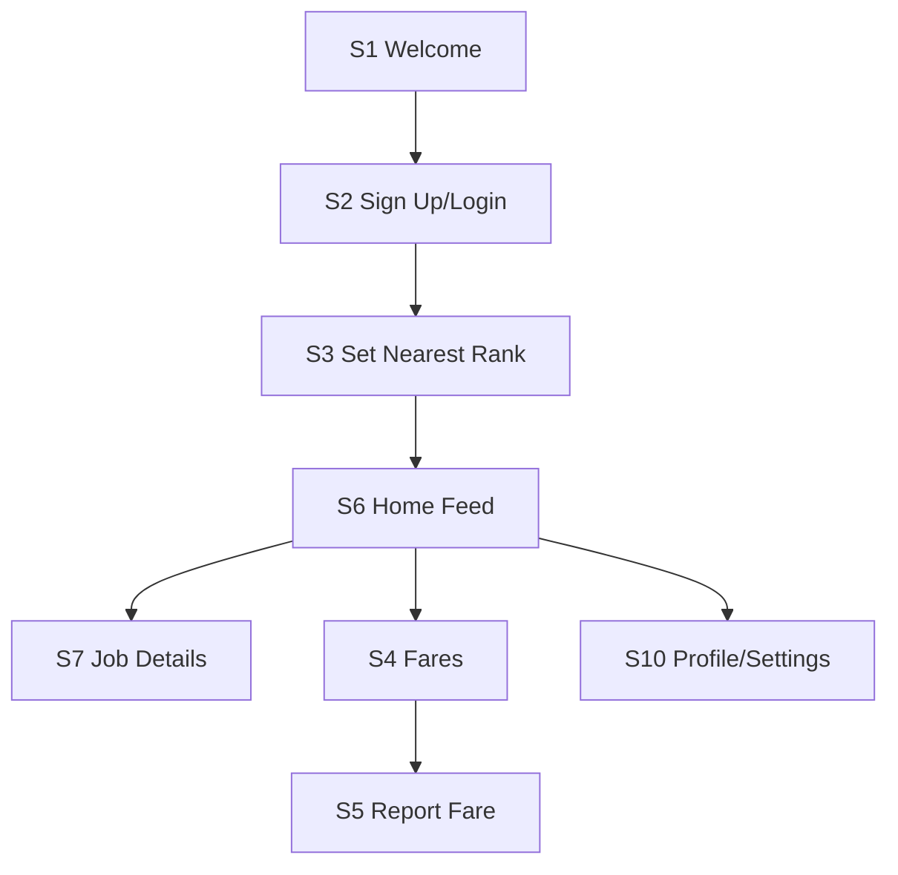

# PRD — Indlela

## Document details

| Field | Answer |
|---|---|
| Product name | Indlela |
| Author(s) | Thami Sithole |
| Course code and cohort | AISD - SNPL2026 |
| Facilitator / reviewer | Mnelisi Maswanganyi |
| Link to your original app idea | docs/IDEA.md in the repository |
| GitHub repository | https://github.com/ThamiRoneo/indlela-mvp |
| Version | v0.1 |
| Status | Approved |

### Change log

| Version | Date | Section(s) changed | What changed | Regenerated? (screens / MASTER.md / none) |
|---|---|---|---|---|
| v0.1 | 28 Oct 2026 | All | First draft | None |

## 1. Product overview

**1.1 Product name:** Indlela

**1.2 One-line pitch** : Indlela helps unemployed youth (18-35) in Rustenburg, North West to affordably reach job opportunities so that transport costs do not block them from attending interviews.

**1.3 Problem statement** : Youth unemployment in North West sits at 58.8% (QLFS Q1:2025), the highest in South Africa. Many first-time job seekers have no work experience and are part of the NEET population (34% of 15-24 nationally). Minibus taxi fares make up a large portion of a job seeker's budget (often up to R1 000/month according to Youth Capital research), and fares continue to rise with petrol prices. Most job boards only show distance or location, with no consideration for affordability. As a result, young people either cannot afford to attend interviews, or have to choose between transport, food and other necessities to do so.

**1.4 Solution** : Indlela is a mobile-first app that makes job seeking affordable by surfacing only opportunities users can actually reach. It uses a crowdsourced Dynamic Fare Index to keep up-to-date minibus taxi fares per rank and route, and factors in AA fuel price trends to forecast fare increases. Its Affordability-First Job Feed sorts opportunities by net gain (estimated wage - estimated transport cost) and allows users to filter to "Jobs I can afford this week". By building on South Africa's existing rank-based taxi network and caching fares offline for low-data use, Indlela helps users budget ahead and avoid wasting limited money on unaffordable interviews.

**1.5 Platform** : Android app (built and tested on Android first). iPhone is a future feature.

**1.6 Vision** : To make transport affordability a standard filter in job seeking across South Africa's most transport-constrained communities, starting with North West.

**1.7 Key terms** : 

| Term | Exact meaning in this app |
|---|---|
| Rank | A designated minibus taxi rank from which users depart for routes (e.g. Rustenburg Taxi Rank) |
| Route | A specific rank-to-destination route with a current estimated fare |
| Fare Report | A crowdsourced user submission of the current fare for a specific Route from a specific Rank |
| Dynamic Fare Index | The app's up-to-date store of fares per Route/Rank, built from Fare Reports and updated with fuel price awareness |
| Job Listing | An opportunity posted or aggregated for users (with wage info where available) shown in the Affordability-First Job Feed |
| Net Gain | Estimated wage minus estimated transport cost (to and from) for a Job Listing, calculated using the Dynamic Fare Index |
| Affordability Filter | "Jobs I can afford this week" filter that only shows Job Listings where Net Gain >= 0 based on the user's weekly transport budget |

## 2. Users, personas and roles

**2.1 Primary user:** Unemployed youth aged 18-35 in Rustenburg, North West. Students or first-time job seekers with little to no work experience. Tech comfort: Low-Medium. Primarily Android phone users on prepaid data with limited budgets for transport and data.

**2.2 Secondary users:** Job-seeking support partners (e.g. Harambee, SETAs, NGOs) - may distribute limited transport vouchers in future. None in v1.

**2.3 Personas**

| Field | Persona 1 | Persona 2 |
|---|---|---|
| Name and age | Lerato Mokoena, 22 | Thabo Molefe, 24 |
| Role (from 2.4) | Job Seeker | Job Seeker |
| Occupation / situation | Unemployed NEET youth in Rustenburg, living with family | Unemployed first-time job seeker in Boitekong, Rustenburg, looking for entry-level work |
| Device and connectivity | Android phone, prepaid data (limited) | Android phone, prepaid data (limited) |
| Tech comfort | Low-Medium | Low-Medium |
| Language(s) | English, Setswana | English, Setswana |
| Goal | Find entry-level jobs she can actually afford to attend interviews for | Budget for transport each week to maximise his chances without going hungry |
| Frustrations today | Fares increase without warning; spends money on interviews she can't afford; data is expensive | Doesn't know if a job is affordable until he has already spent fare money; job boards don't show transport costs |
| How the app helps | Sees "Jobs I can afford this week" based on current fares from her rank; gets alerts if fares are likely to increase | Uses the Dynamic Fare Index offline to check fares at his rank and only applies to jobs with positive net gain |
| Quote | "I need to know if I can afford to go before I spend the fare." | "If I can't afford both food and taxi this week, I can't risk an interview." |

**2.4 Roles and permissions**

| Role | How someone gets this role | Can do | Cannot do |
|---|---|---|---|
| Job Seeker | Signs up with email and password (18+) | View fares per rank/route, report fares, view affordability-first job feed, filter by affordability/budget, set nearest rank, view job details | Post job listings (v1), access partner voucher systems (v1), edit others' fare reports |
| Admin | Set via database (Supabase) in v1 | Review and moderate fare reports if spammy (via dashboard), manage aggregated job sources (v1) | No admin screens in app in v1 |

**2.5 Admin:** Admin work is done directly in the database/dashboard (Supabase) in v1; there are no admin screens in the app.

## 3. Goals, success metrics and non-goals

**3.1 Goals**

| # | Goal | Metric | Target | How you will check it |
|---|---|---|---|---|
| G1 | Help users find affordable opportunities | % of viewed job listings marked as "affordable" (Net Gain >= 0) | >= 70% | Log feed impressions with affordability calculation against Dynamic Fare Index |
| G2 | Keep fares accurate for Rustenburg | % of top 5 Rustenburg ranks with >= 3 Fare Reports in last 7 days | >= 80% | Count FareReport rows per (rank, route) in last 7 days |
| G3 | Save users money / prevent wasted trips | % of tested users who say they avoided applying to an unaffordable job after using Indlela | >= 60% of 10 tested users | Post-test survey with 10 classmates/users |

**3.2 Non-goals**

- Full ride hailing/carousel booking: No booking of taxis/cars in v1.
- General carpooling: Open carpooling removed.
- Voucher redemption system: Not in v1.
- User-to-user messaging: No chat/messaging in v1.
- Push notifications at scale: Basic in-app alerts only if simple.
- Expanding beyond Rustenburg at launch: Focus solely on Rustenburg, North West for MVP.

## 4. Features, business rules and notifications

**4.1 Feature list**

| ID | Feature name | What the user can do | Priority | Goal | Stories | Screens |
|---|---|---|---|---|---|---|
| F1 | Onboarding & Accounts | Sign up, log in, log out, set nearest rank, basic profile setup | Must | G1,G2 | US1,US2,US3 | S1,S2,S3,S10 |
| F2 | Dynamic Fare Index | View fares by rank/route, report/update fare, see fuel-price aware alerts, use offline cached fares | Must | G2,G3 | US4,US5 | S4,S5 |
| F3 | Affordability-First Job Feed | View jobs sorted by Net Gain, filter "Jobs I can afford this week", set weekly transport budget, view job details with transport cost breakdown | Must | G1,G3 | US6,US7 | S6,S7 |
| F4 | Fare Alerts & Budgeting | Set weekly transport budget, get alerts when fares likely to increase, see remaining budget estimate | Should | G3 | US8 | S5,S10 |
| F5 | Data-light & Offline Support | Cache top ranks/fares offline, show cached data when offline, indicate staleness of fares | Should | G3 | US9 | S4,S5 |

**4.2 MVP definition:** The smallest version is Indlela with a Dynamic Fare Index and an Affordability-First Job Feed.

**4.3 Future features:** Fare voucher wallet, rank-based carpools, expansion to other areas, push notifications, iOS app.

**4.4 Business rules**

| ID | Rule | Used by |
|---|---|---|
| BR1 | User must set a nearest rank on first use. | F1, S2, S3 |
| BR2 | Fare valid if reported in last 14 days; else show staleness. | F2, S4, S5 |
| BR3 | Max 5 Fare Reports per user per day. | F2, S5 |
| BR4 | Net Gain = Wage - (to-and-fro transport cost) using nearest rank fares. | F3, S6, S7 |
| BR5 | "Jobs I can afford this week" requires Net Gain >= 0 and within budget. | F3, S6 |
| BR6 | Weekly transport budget defaults to unset. | F3, F4, S6, S10 |
| BR7 | If fuel price up >= 5% in 30 days, show fuel-aware alert. | F2, F4, S4, S5 |
| BR8 | Cache top ranks/routes for 7 days offline. | F5, S4 |

**4.5 Notifications**

| Trigger | Who receives it | Channel | Exact text | Tapping it opens |
|---|---|---|---|---|
| Fares may increase | Users with nearest rank set in affected area | In-app | "Fares may increase soon. Check updated fares for your rank." | S4 |
| Fare reported successfully | User who submitted | In-app | "Thanks! Fare reported for [Route]." | S4 |
| Stale fares detected | User viewing feed | In-app | "Some fares are out of date. Report current fares to stay accurate." | S5 |

## 5. Accounts and sign-in

| Decision | Answer |
|---|---|
| Sign-up methods | Email + password only |
| Who may sign up | Anyone 18 or older with an email address |
| Minimum age | 18 with confirmation checkbox |
| Password rules | At least 8 characters, including at least 1 number |
| Forgot password | Available if auth configured |
| Failed log-in attempts | 5 wrong attempts → 15 min lockout |
| Stay logged in | 30 days |
| Log out | Available from Profile/Settings |
| Delete account | Available in v1 |

## 6. User stories, acceptance criteria and edge cases

**6.1 Stories**

**US1:** As a new user, I want to set my nearest rank.  
T-US1-1: Prompted on onboarding; saved.

**US4:** As a user, I want to see current fares.  
T-US4-1: Fares shown with staleness; offline cached if available.

**US5:** As a user, I want to report a fare.  
T-US5-1: Submit works if under 5/day limit.

**US6:** As a user, I want to see affordable jobs.  
T-US6-1: Sorted by Net Gain; filterable.

**6.2 Edge cases**

| Situation | What the user sees | What the app does |
|---|---|---|
| No fare data | "Transport cost unknown" | Excluded from strict affordable filter |
| Stale fares (>14 days) | "Last reported X days ago (stale)" | Flagged as stale |
| Offline, no cache | "No cached fares available." | Cannot calculate transport costs |
| Over report limit | "You've reported 5 fares today. Try again tomorrow." | Blocked |

## 7. User flows and navigation map

**Flow 1:** Onboarding → Set rank → Home Feed  
**Flow 2:** Fares → Report Fare  
**Flow 3:** Feed → Filter affordable jobs

**Navigation map:** Tabs S6 Home, S4 Fares, S10 Profile/Settings

## 8. Screens, modals and UI states

**8.1 Screen list**

| ID | Screen name | Purpose | Primary action | Features |
|---|---|---|---|---|
| S1 | Welcome | Entry | Sign up/Log in | F1 |
| S2 | Sign Up / Log In | Auth | Authenticate | F1 |
| S3 | Set Nearest Rank | Onboarding | Select rank | F1 |
| S4 | Fares | View fares | View/Report | F2,F4,F5 |
| S5 | Report Fare | Submit fare | Submit report | F2 |
| S6 | Home Feed | Jobs feed | Browse/filter | F3,F4 |
| S7 | Job Details | Details + transport breakdown | View details | F3 |
| S10 | Profile/Settings | Settings | Budget/rank/logout | F1,F4 |

## 9. Data model

| Entity | Fields | Relations | Notes |
|---|---|---|---|
| User | id, email, password_hash, nearest_rank_id, weekly_transport_budget | has many FareReport | 18+ |
| Rank | id, name, city, province | has many Route, FareReport | Rustenburg focused |
| Route | id, rank_id, destination | belongs to Rank, has many FareReport | |
| FareReport | id, user_id, rank_id, route_id, amount_zar, created_at | belongs to User,Rank,Route | Max 5/day |
| JobListing | id, title, company, wage_zar, location, description, source_url, created_at | — | Seeded in v1 |
| FuelPriceSnapshot | id, date, petrol_price_zar, source | — | For alerts |

## 10. APIs / integrations

| Integration | Purpose | Method | Auth | Required |
|---|---|---|---|---|
| Auth/DB (Supabase) | Auth and data storage | SDK/REST | Keys + RLS | Yes |
| AA Fuel Price | Fuel alerts | Manual snapshot in v1 | None | Recommended |
| Job source | Job listings | Manual/CSV in v1 | None | Yes |

## 11. Permissions, privacy and security

| Item | Answer |
|---|---|
| Data collected | Email, nearest rank, budget, fare reports |
| Permissions | None required in v1 |
| Security | RLS, password hashing, data minimisation |
| Privacy | Age gate 18+, delete account supported |

## 12. Build plan, milestones and MVP cut

**Milestones:** M1 Setup, M2 Fares MVP, M3 Jobs + Affordability, M4 Polish & Test  
**MVP cut:** Must have F1,F2,F3.

## 13. Testing, acceptance and open questions

**Acceptance:** Set rank, view/report fares with limits, feed sorted by Net Gain, affordability filter works, offline cached fares shown.

**Open questions:**
- Job listing source for v1 (manual/CSV)?
- Auth/DB provider confirmation?
- AA fuel data source (manual snapshot acceptable)?

## 14. Glossary

| Term | Definition |
|---|---|
| Fare Report | User-submitted fare for rank-route |
| Net Gain | Wage minus transport cost |
| NEET | Not in Employment, Education or Training |
| QLFS | Quarterly Labour Force Survey |
| Rank | Minibus taxi rank |
| Staleness | Fare > 14 days old marked stale |

## 15. Appendix

Original app idea: [docs/IDEA.md](https://github.com/ThamiRoneo/indlela-mvp/blob/main/docs/IDEA.md) (Indlela App Concept Document)
